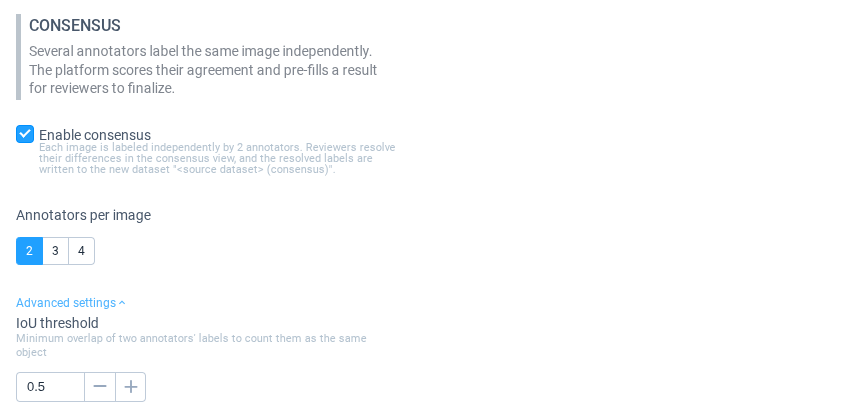
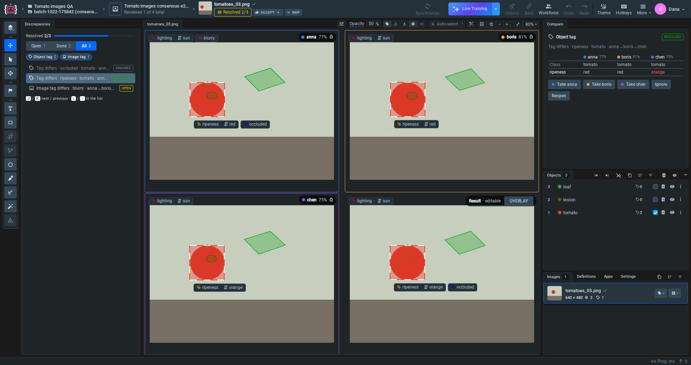
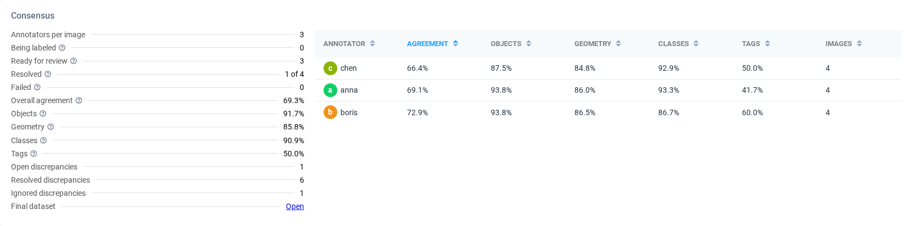

# Image Consensus

**Image Consensus** is a mode of [Labeling Queues](Labeling-Queues.md) for image projects. It works like [Video Consensus](video-consensus.md): each image is labeled independently by several annotators. When the last of them submits it, the platform compares their versions, scores the agreement and creates a pre-filled **Result**. A reviewer then settles every difference in the consensus view and accepts the image. The final labels go to a separate dataset, and the queue statistics show how well each annotator agrees with the others.

Consensus is built into the platform, so you do not need to install or launch an app.

## How it works

1. A manager creates a Labeling Queue for an image project, turns on **Enable consensus** and chooses how many annotators label each image (2 to 4).
2. The queue gives every image to that many different annotators. Each annotator sees only their own labels and tags.
3. When the last annotator submits an image, the platform matches their labels, lists the differences (**discrepancies**) and scores the agreement. It copies the image to the final dataset `<dataset> (consensus)` with a pre-filled **Result**: the labels most of the annotators agree on.
4. A reviewer opens the image in the consensus view, settles each discrepancy and clicks **Accept**.
5. The final dataset contains only the reviewed labels. The annotators' original labels remain in the source dataset.

## Step 1. Create a consensus queue

Create a Labeling Queue as usual (see [Labeling Queues](Labeling-Queues.md)), select an image project and dataset, and turn on **Enable consensus** in the **Consensus** section.

| Setting | Default | What it does |
| --- | --- | --- |
| **Annotators per image** | 2 | How many different annotators label each image, from 2 to 4. |
| **IoU threshold** | 0.5 | How much two annotators' labels must overlap to count as the same object, from 0.1 to 0.95. It is under **Advanced settings**. |

Images have no **Frame tolerance**. The other rules are the same as for videos: **Assign to** needs at least as many users as **Annotators per image**, reviewers should not be the queue's annotators, and **Quality Check**, re-annotation and multi-view are not available with consensus.

## Step 2. Annotators label

Annotators label and submit images in their jobs as in any other queue. They see only their own labels and image tags, even if the project allows several tags of one kind per image. When the last annotator submits an image, the platform scores it in the background, and the image appears in the queue statistics as **Ready for review**.

## Step 3. Review the discrepancies

A reviewer opens their job in the queue. Images from consensus queues open in the consensus view:

* **Annotator views** show each annotator's labels and image tags, read-only, in their own colour. The chip shows the annotator's agreement on this image; hover over it to see the components.
* **Result** is the final version, and you can edit it like any annotation. The **Overlay** button draws the annotators you pick on top of each other in one view.
* **Discrepancies** lists everything the annotators disagree on. Filter it by status or type, and move through it with <kbd>J</kbd> / <kbd>K</kbd>.
* **Compare** shows each annotator's version of the selected discrepancy and the actions:
  * **Take &lt;annotator&gt;** copies that annotator's version into the Result and marks the discrepancy **resolved**: their label (or none, if they have none), their class, or their values of the tag.
  * **Ignore** leaves the Result as it is and marks the discrepancy **ignored**.
  * **Reopen** sets a resolved or ignored discrepancy back to **open** without changing the Result.

When every discrepancy is settled, click **Accept** to finish the image and move to the next one.

### Discrepancy types

| Type | Reported when |
| --- | --- |
| **Shape** | With three or more annotators, the object's labels match pairwise but some pair overlaps less than the IoU threshold. |
| **Missing** | Some annotators labeled the object and others did not. |
| **Only one** | Only one annotator labeled the object. |
| **Class** | Annotators gave the object different classes. |
| **Object tag** | Annotators gave the object different tags or values. |
| **Image tag** | Annotators gave the image different tags or values. |

## Step 4. Monitor agreement

Click **Stats** on the queue to see the **Consensus** card. It is the same as for videos, without the **Frames** component:

## How agreement is calculated

Agreement uses the same rule as [Video Consensus](video-consensus.md#how-agreement-is-calculated), with an image treated as a single frame:

$$\text{Agreement} = \text{Objects} \times \text{mean}(\text{Geometry}, \text{Classes}, \text{Tags})$$

* **Matching**: for each pair of annotators, labels are matched one to one by IoU, ignoring the class, and only pairs with IoU at or above the **IoU threshold** are matched. Matched labels form a group: one real object with each annotator's version of it. Each annotator has at most one label per group, so a second, overlapping label of the same annotator is a separate **Only one** object.
* **Objects** is the F1 of the two annotators' objects: $$2 \times$$ shared objects over the objects of both.
* **Geometry** is the mean IoU of the shared objects' labels, **Classes** the share of shared objects with the same class, and **Tags** the share of label tags (on shared objects) and image tags that match.
* Counts are added up over pairs of annotators, images and the queue before they are divided, exactly as for videos.

In the statistics above, for example, the queue's agreement is $$91.7\% \times (85.8 + 90.9 + 50.0) / 3 = 69.3\%$$.

Points and polylines are compared as strokes 2% of the image diagonal wide (at least 9 pixels), and alpha masks by the pixels they cover.

### How the Result is pre-filled

With $$K$$ annotators, an object gets a label in the Result when at least $$\lceil K/2 \rceil$$ annotators labeled it (with two annotators, when either did). The label is the one that overlaps the others best, copied as drawn. It gets the class most annotators chose and the label tags of the annotator who agrees best with the others. An image tag is added when at least $$\lceil K/2 \rceil$$ annotators used it, with the values most of them chose. Ties go to the annotator who submitted first.

## Limitations

* 2 to 4 annotators per image.
* Multi-view (grouped images) queues and Quality Check cannot be combined with consensus.
* An image is scored once, when the last annotator submits it.
* Agreement is measured at one IoU threshold: two labels that overlap just below it are two **Only one** objects.
