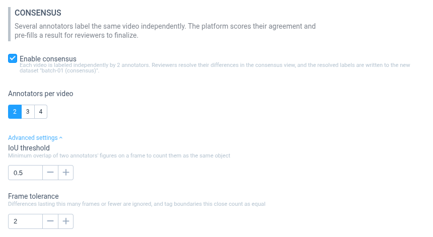
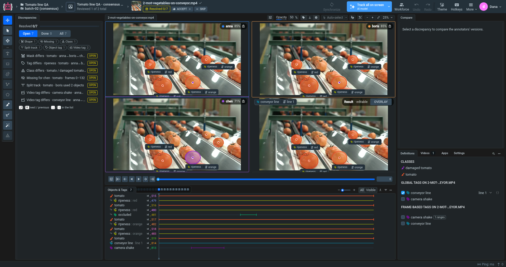
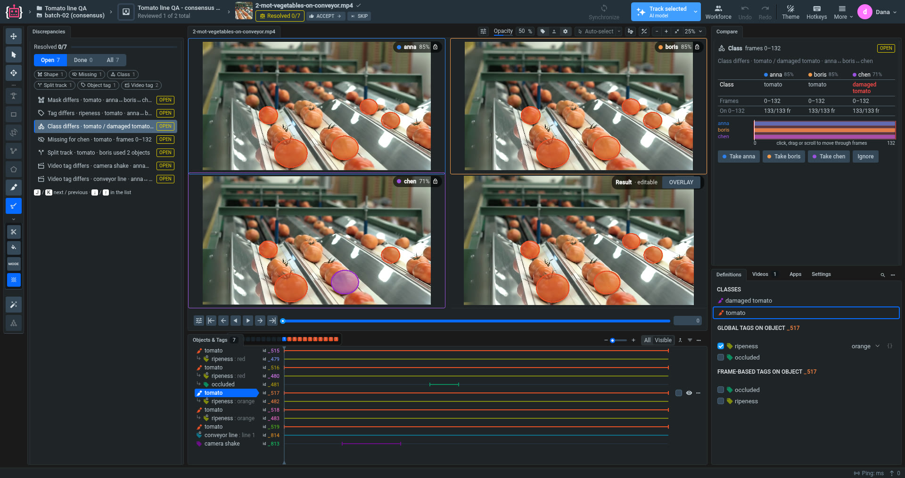
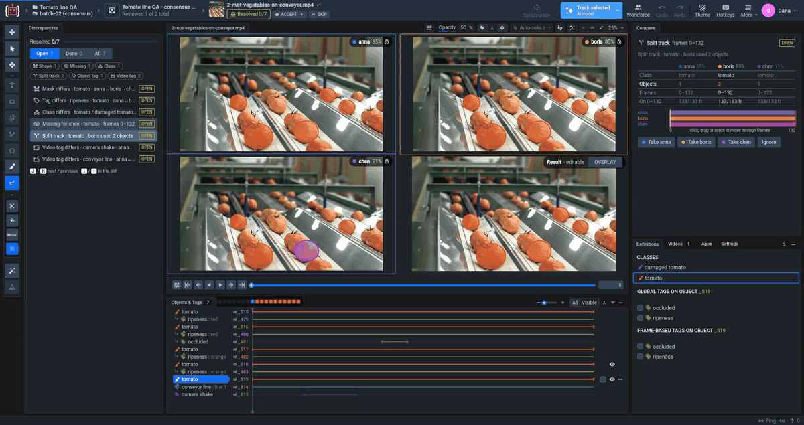
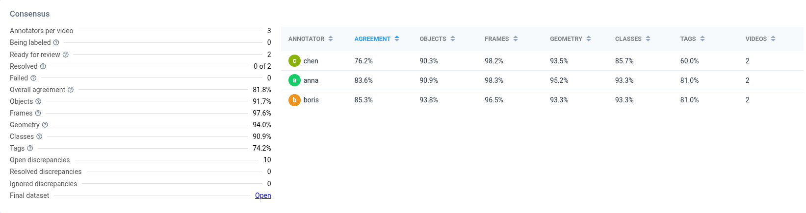

# Video Consensus

**Video Consensus** is a mode of [Labeling Queues](Labeling-Queues.md) for video projects. Each video is labeled independently by several annotators. When the last of them submits it, the platform compares their versions, scores the agreement and creates a pre-filled **Result**. A reviewer then settles every difference in the consensus view and accepts the video. The final labels go to a separate dataset, and the queue statistics show how well each annotator agrees with the others.

Consensus is built into the platform, so you do not need to install or launch an app.

Use it when label quality matters more than labeling speed:

* **Ground truth for training and evaluation**: every object, frame range and tag in the final dataset was confirmed by more than one person or settled by a reviewer.
* **Ambiguous classes**: when annotators often disagree on a class (for example, the severity of a defect), consensus shows where and how often this happens.
* **Annotator quality**: agreement per annotator shows who labels differently from the rest of the team, and in which aspect.


Consensus in Labeling Queues is available for **video** projects. For images, use the [Labeling Consensus](Labeling-Consensus.md) app.


## How it works

1. A manager creates a Labeling Queue with **Enable consensus** turned on and chooses how many annotators label each video (2 to 4).
2. The queue gives every video to that many different annotators. Each annotator sees only their own labels.
3. When the last annotator submits a video, the platform matches their objects, lists the differences (**discrepancies**) and scores the agreement. It copies the video to the final dataset `<dataset> (consensus)` with a pre-filled **Result**: the labels most of the annotators agree on.
4. A reviewer opens the video in the consensus view, settles each discrepancy and clicks **Accept**.
5. The final dataset contains only the reviewed labels. The annotators' original labels remain in the source dataset.

## Step 1. Create a consensus queue

Create a Labeling Queue as usual (see [Labeling Queues](Labeling-Queues.md)), select a video project and dataset, and turn on **Enable consensus** in the **Consensus** section.

| Setting | Default | What it does |
| --- | --- | --- |
| **Annotators per video** | 2 | How many different annotators label each video, from 2 to 4. |
| **IoU threshold** | 0.5 | How much two annotators' shapes must overlap on a frame to count as the same object, from 0.1 to 0.95. Matched shapes that overlap less than this are reported as a **Shape** discrepancy. |
| **Frame tolerance** | 2 | Differences that last this many frames or fewer are not reported, and tag boundaries this close count as equal, from 0 to 30. Use it so that starting a track one or two frames later does not need review. |

**IoU threshold** and **Frame tolerance** are under **Advanced settings**.

Some queue settings work differently with consensus:

* **Assign to** must include at least as many users as **Annotators per video**. One annotator never labels the same video twice.
* Annotators always see only their own labels, so they label independently.
* Reviewers should not be the queue's annotators, unless **Allow to review own annotations** is on. Otherwise some videos may have no reviewer who is allowed to resolve them.
* **Quality Check** and the re-annotation settings are not available: reviewers fix the Result themselves instead of sending videos back.
* Multi-view queues do not support consensus.

In the queue list, consensus queues are marked with a **Consensus ×N** badge.

## Step 2. Annotators label

Annotators work in their jobs as in any other queue: they label a video and submit it with **Confirm**. Each video is given to the required number of different annotators. The queue shows a video to the next annotator even if another one is still labeling it.

When the last annotator submits a video, the platform scores it in the background. This usually takes a few seconds, but it may take longer for long videos with many masks. The video then appears in the queue statistics as **Ready for review**.

## Step 3. Review the discrepancies

A reviewer opens their job in the queue. Videos from consensus queues open in the consensus view:

* **Annotator views** (one per annotator, each in its own colour) are read-only. The chip in the corner shows the annotator's agreement with the others on this video. Hover over it to see the components (see [How agreement is calculated](#how-agreement-is-calculated)).
* **Result** is the final version, and you can edit it like any annotation. It starts pre-filled: an object appears on a frame when at least half of the annotators labeled it there (with two annotators, when either of them did). The **Overlay** button switches between side-by-side annotator views and one view that draws the annotators you pick on top of each other.
* **Discrepancies** lists everything the annotators disagree on. Filter the list with **Open**, **Done** and **All** or by type, and move through it with <kbd>J</kbd> / <kbd>K</kbd>.
* **Compare** shows the selected discrepancy: what each annotator labeled, on which frames, and a timeline you can drag or scroll to move through the frames.

For each discrepancy, choose one of the actions in **Compare**:

* **Take &lt;annotator&gt;** copies that annotator's version into the Result and marks the discrepancy **resolved**. For **Shape**, **Missing**, **Only one** and **Split track**, the Result's shapes on the discrepancy's frames are replaced with the annotator's shapes; if the annotator has nothing there, they are removed. For **Class**, the Result object gets the annotator's class. For a tag, the Result's values of that tag are replaced with the annotator's. Hover over the button to see exactly what will change.
* **Ignore** leaves the Result as it is and marks the discrepancy **ignored**.

You can also edit the Result directly with the usual tools, for example when no annotator got it right, and then **Ignore** the discrepancy.

[Download the full-resolution video (WebM)](https://github.com/supervisely/docs/raw/refs/heads/master/.gitbook/assets/consensus-video-review-navigation.webm).

When every discrepancy is settled, click **Accept** to finish the video and move to the next one. If you accept with open discrepancies, the platform asks for confirmation, and the Result keeps its pre-filled version for them.

### Discrepancy types

| Type | Reported when |
| --- | --- |
| **Shape** | Annotators labeled the object on the same frames, but their shapes overlap less than the IoU threshold. |
| **Missing** | Some annotators labeled the object on frames where others did not. |
| **Only one** | Only one annotator labeled the object. |
| **Class** | Annotators gave the object different classes. |
| **Split track** | One annotator labeled a single object as several objects, one after another. |
| **Object tag** | Annotators gave the object different tags, values or frame ranges. |
| **Video tag** | Annotators gave the video different tags, values or frame ranges. |

**Shape**, **Missing** and **Only one** differences that last no more than **Frame tolerance** frames are not reported. For tags, **Frame tolerance** is how far two frame ranges may start or end apart and still count as equal.

## Step 4. Monitor agreement

Click **Stats** on the queue to see the **Consensus** card:

* **Being labeled**, **Ready for review**, **Resolved** and **Failed** count the videos at each stage. **Failed** lists videos whose consensus could not be computed.
* **Overall agreement** and its five components, pooled over the queue's videos (see [From pairs to videos and queues](#from-pairs-to-videos-and-queues)).
* **Open**, **Resolved** and **Ignored discrepancies** show how much review work is left.
* The annotator table shows each annotator's agreement with the others and its components. Sort by a column to find who differs most and in which aspect.
* **Final dataset** opens the dataset with the reviewed videos.

## How agreement is calculated

Agreement is a number from 0% to 100% that measures how similar the annotators' versions of a video are. It is built from five components, each from 0% to 100%:

| Component | Question it answers | Related discrepancies |
| --- | --- | --- |
| **Objects** | Did the annotators find the same objects? | **Only one** |
| **Frames** | On objects both labeled, did they label the same frames? | **Missing** |
| **Geometry** | On objects both labeled, how closely do their shapes overlap? | **Shape** |
| **Classes** | On objects both labeled, did they choose the same class? | **Class** |
| **Tags** | Did they give the same tags, values and frame ranges? | **Object tag**, **Video tag** |

**Objects** measures how many objects the annotators found in common. The other four measure how well they agree on the objects they both found. The overall agreement combines the two:

$$\text{Agreement} = \text{Objects} \times \text{mean}(\text{Frames}, \text{Geometry}, \text{Classes}, \text{Tags})$$

This follows the structure of Panoptic Quality ([Kirillov et al.](https://arxiv.org/abs/1801.00868)), a standard metric for comparing segmentations, including between two human annotators: the share of objects matched, times how good the matches are. Unlike Panoptic Quality, where match quality is the mean IoU alone, here it is the mean of four rates, each with equal weight. A component measured on a few items, such as **Tags** on a video with two or three tags, moves the agreement as much as **Geometry** measured over thousands of frames. An object that only one annotator found counts as complete disagreement. An annotator who found 1 of 10 objects and labeled it perfectly agrees on about 18%, not on the near 100% the four quality components alone would suggest.

A low component points to the kind of mistake. For example, high **Objects** with low **Geometry** means the annotators find the same objects but outline them differently.

Components and discrepancies answer different questions, so they do not always move together. Components measure every difference, including ones shorter than **Frame tolerance** and shapes that overlap less than perfectly but still above the **IoU threshold**. Discrepancies list only the differences a reviewer has to settle. A component can be below 100% on a video with no discrepancies, and a **Split track** is a discrepancy that lowers no component.

### Matching objects

Before scoring, the platform decides which objects of different annotators are the same real object:

1. **On every frame**, the shapes of each pair of annotators are matched one to one by IoU (intersection over union). Only pairs with IoU at or above the **IoU threshold** are matched. The class does not matter, so an object two annotators drew in the same place with different classes is one object with a **Class** discrepancy, not two different objects.
2. **Across frames**, two annotators' objects are linked when they were matched on at least 30% of the frames where either of them exists, or on at least half of the frames of the shorter one (and on at least 10 frames). The second rule links a short piece of a split track, or an object one annotator labeled only on part of its frames, to the other annotator's full track. The 10-frame minimum keeps two different objects that cross each other briefly apart. Linked objects form a **group**: one real object with each annotator's version of it.
3. One annotator can have several objects in a group only if they never appear on the same frame. This is a **Split track**: one real object labeled as several objects, one after another.

An object only one annotator has is a group of one. If an annotator's object has several shapes on one frame, only the first one counts. Points and polylines have almost no area, so for IoU they are drawn with a width of 2% of the frame diagonal (at least 9 pixels; about 44 pixels in Full HD), the way lane benchmarks draw lanes. A point is drawn as a disc of that diameter. Two annotators' points a few pixels apart then overlap substantially instead of not at all.

### The components

Each component is a ratio of two counts. For two annotators $$A$$ and $$B$$ on one video, where *shared* means the groups both labeled:

| Component | Numerator | Denominator |
| --- | --- | --- |
| **Objects** | $$2 \times$$ shared groups | groups of $$A$$ + groups of $$B$$ |
| **Frames** | $$2 \times$$ frames where both labeled a shared group | frames of $$A$$ + frames of $$B$$ on shared groups |
| **Geometry** | sum of the IoU of $$A$$'s and $$B$$'s shapes on those frames | frames where both labeled a shared group |
| **Classes** | shared groups where $$A$$ and $$B$$ chose the same classes | shared groups |
| **Tags** | tag names that match | tag names compared |

* **Objects** and **Frames** are F1 scores: they reward finding the same objects and frames and penalise both misses and extras.
* **Geometry** is the mean IoU over the frames both labeled. Here IoU is not cut off at the threshold: on a frame where the two shapes of a matched object overlap with IoU 0.3, that frame adds 0.3.
* **Classes**: if an annotator split an object into pieces with different classes, all of these classes count, so changing the class along the object is a disagreement even if the longest piece agrees.
* **Tags**: each tag name is compared on every shared group (object tags) and on the video (video tags). A tag matches when both annotators have the same values and their frame ranges start and end within **Frame tolerance** of each other. A tag that one annotator has and the other does not is a mismatch. Touching ranges with the same value are merged first, so a range drawn in two strokes equals one drawn at once.

A component whose denominator is 0 has nothing to compare (for example, **Classes** when the two annotators share no objects, or **Tags** when neither used any tags). It is left out and does not count as 0% or 100%. If nobody labeled any objects, the agreement is the **Tags** component alone. If nobody labeled anything, the video has no agreement and does not count in the queue statistics.

### From pairs to videos and queues

Counts are added up before they are divided, the way Krippendorff's alpha pools all pairs of raters and tracking benchmarks pool all videos. Every compared object, frame and tag carries the same weight, wherever it comes from:

* **Video agreement**: the counts of all pairs of annotators are added up per component. With three annotators who all labeled the same 10 objects, if one of them gives 1 object a different class, **Classes** is 28 of 30 compared pairs, 93%; if they give all 10 a different class, it is 10 of 30, 33%.
* **An annotator's agreement on a video** (the chip in the consensus view): the same, over only the pairs this annotator is in.
* **Queue agreement**: the counts of all scored videos are added up, so a long video with many objects weighs more than a short one with a few. The same applies to each annotator in the annotator table, over the videos they labeled.

At every level, the overall agreement follows from the components shown next to it: **Objects** times the mean of the other four.

### Example

Two annotators label one video. Anna labels 3 tomatoes, and Boris labels 2 of the same tomatoes and nothing else.

| Component | Calculation | Value |
| --- | --- | --- |
| Objects | 2 shared out of 3 + 2: $$2 \cdot 2 / 5$$ | 80% |
| Frames | On the shared tomatoes, Anna labeled 200 frames and Boris 190, all of them also labeled by Anna: $$2 \cdot 190 / 390$$ | 97.4% |
| Geometry | Mean IoU of their shapes on those 190 frames | 85% |
| Classes | They chose the same class for 1 of 2 shared tomatoes | 50% |
| Tags | 3 of 4 compared tags match | 75% |
| **Agreement** | $$80\% \times (97.4 + 85 + 50 + 75) / 4 = 80\% \times 76.9\%$$ | **61.5%** |

They agree on 76.9% of what they both labeled, but Boris missed one of the three tomatoes, which brings the agreement down to 61.5%.

With only two annotators, each annotator's agreement on this video is the same 61.5%. With three, Anna's counts are added up over her pairs with the other two annotators.

### How the Result is pre-filled

With $$K$$ annotators, the **quorum** is $$\lceil K/2 \rceil$$: 1 of 2, 2 of 3, 2 of 4.

* **Shapes**: a group gets a shape on a frame when at least a quorum of annotators labeled it there. The shape is the one that overlaps the others best on that frame (the highest mean IoU). The shape is copied as drawn, not averaged.
* **Class**: the class most annotators chose for the group. For a split track, the class of its longest piece is the annotator's vote.
* **Object tags**: those of the annotator whose version of the group was matched with the others on the most frames.
* **Video tags**: a tag is added when at least a quorum of annotators used it, with the values most of them chose.

Ties go to the annotator who submitted the video first. Pre-fill only proposes a version: whatever the annotators disagree on is still listed as a discrepancy for the reviewer.

## Limitations

* Only video projects are supported. For images, use the [Labeling Consensus](Labeling-Consensus.md) app.
* 2 to 4 annotators per video.
* Multi-view queues and Quality Check cannot be combined with consensus.
* A video is scored once, when the last annotator submits it. Labels changed in the source dataset afterwards are not scored again.
* Objects are linked across annotators only when they were matched on enough frames (see [Matching objects](#matching-objects)). Two versions of one object that match on too few frames, for example because they overlap in time only briefly, are not linked: the object is reported as **Only one** for each of them, rather than as **Missing** frames, and **Objects** drops accordingly.
* Agreement is measured at one IoU threshold. Two shapes that overlap just below it are not matched, so a small change in overlap can turn a matched object into two **Only one** objects. On a video with few objects this moves the agreement a lot; the queue's agreement, pooled over many objects, is much less sensitive.
