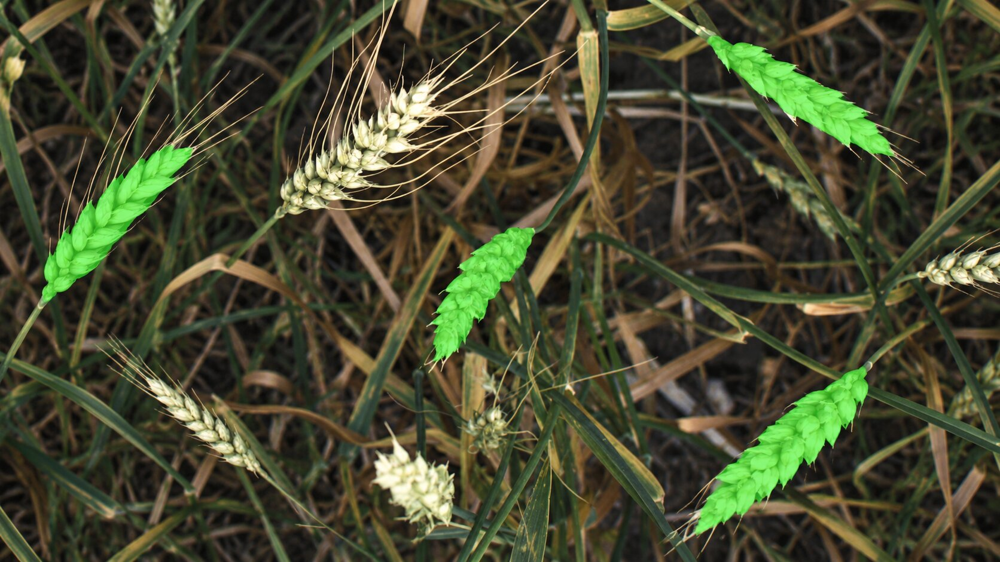
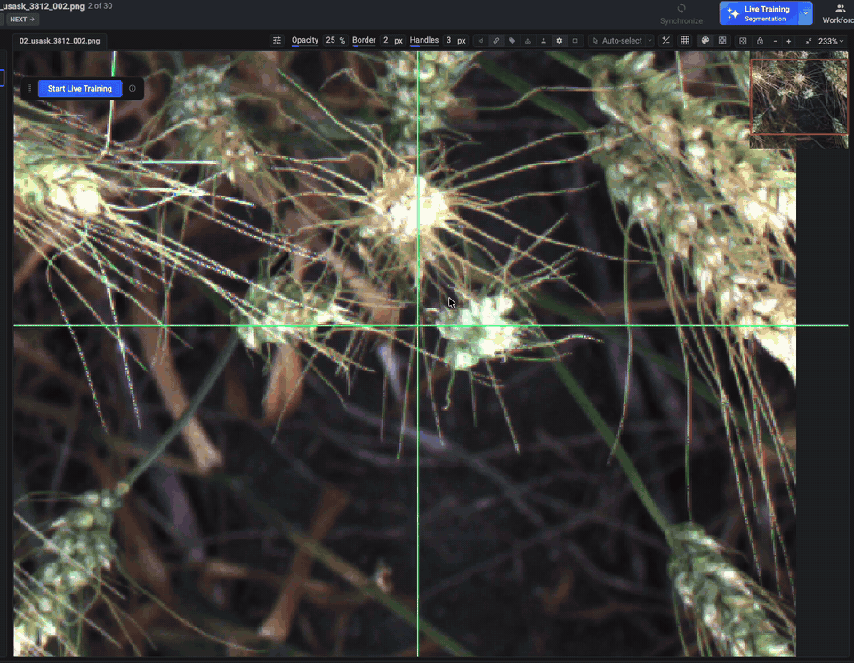
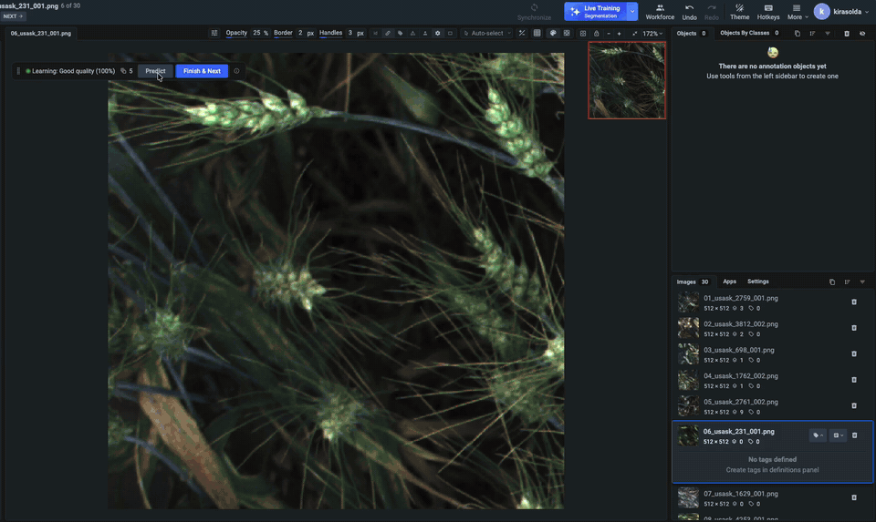

---
keywords:
  - wheat head segmentation
  - wheat spike segmentation
  - plant phenotyping
  - instance segmentation
  - mask annotation
  - live training
  - active learning
  - agricultural computer vision
  - field phenotyping
  - supervisely
description: >-
  Annotate wheat head masks in field images with Live Training – Segmentation,
  which starts predicting instance masks after the first 5–10 labeled images.
---

# Wheat Head Segmentation with Live Training

<figure></figure>

## The Dataset Creation Challenge

ML engineers, data scientists, and plant phenotyping teams face a critical challenge when building segmentation models for wheat field images: the model must outline every wheat head pixel by pixel, and training it requires pixel-accurate masks. This guide demonstrates how Supervisely's **Live Training – Segmentation** reduces mask annotation time, so the training dataset is ready sooner.

### Wheat Head Phenotyping for Breeding Programs

**The Scenario**

A breeding program tests dozens of wheat cultivars in field plots. A ground phenotyping vehicle drives along the plots and captures top-down RGB images of the canopy. Breeders need plot-level measurements from these images: the number of heads per area and the size of each head, both of which are components of yield.

**The Problem**

Counting and measuring heads by eye is slow and subjective, and it does not scale to thousands of plots imaged several times per season. Bounding boxes are enough to count heads, but a box also covers awns, leaves, and parts of neighboring heads, so it cannot measure head size or shape. These traits need segmentation masks, and the wheat canopy makes them hard to draw: heads overlap, leaves partly hide them, and awns cross the head outline.

**The Solution Approach**

The program trains a segmentation model on its own field images. But first, it needs hundreds of images with pixel-accurate masks of wheat heads.

## Computer Vision in Wheat Phenotyping: Research Evidence

Recent research demonstrates the effectiveness of computer vision for wheat head analysis in the field:

* [Global Wheat Head Detection (GWHD) Dataset](https://doi.org/10.34133/2020/3521852) (David et al., Plant Phenomics, 2020) collected 4,700 high-resolution field images with 190,000 wheat heads labeled with bounding boxes to develop and benchmark head detection methods.
* [The Global Wheat Full Semantic Organ Segmentation (GWFSS) Dataset](https://doi.org/10.1016/j.plaphe.2025.100084) (Wang et al., Plant Phenomics, 2025) moved from boxes to pixel-level masks of heads, leaves, and stems in 1,096 images from 11 institutions. The authors point to yield components such as spike number and spikelet size as traits these masks support. Baseline models reached about 90% mIoU for heads and leaves.

These studies show that head detection and segmentation work on real field images, but every model depends on a large set of labeled heads: the GWHD dataset alone contains 190,000 of them.

## Demonstration Dataset: Wheat Canopy at Heading

To solve the challenge described above, we first need to create a training dataset. We use 30 top-down images of a wheat canopy at heading to demonstrate how Live Training accelerates mask annotation. The images come from the public GWFSS dataset (USASK subset) and were taken with one camera setup in one field trial, so the model learns one consistent scene.

The project has one class, `head`, with the **Mask** shape. Awns, leaves, stems, and soil are not annotated and remain background.

**The Problem**

Manual labeling from scratch, no predictions, no learning: 5–15 heads per image are outlined one by one, with awns erased and heads hidden behind leaves traced by hand.

**The Solution**

Live Training – Segmentation predicts head masks after the first few images. You correct the masks instead of drawing them.

## Live Training – Segmentation

### Create Initial Masks with the Smart Tool

The first images are labeled manually. With the **Smart Tool**, draw a box around a wheat head, and the model returns its mask. Add positive or negative points if the mask needs refining, then press `SPACE` to finish the head before starting the next one, so every head becomes a separate object.

<!-- GitHub review: animated GIF fallback. For GitBook publication, upload manual-wheat-head-annotation.mp4 and embed its hosted URL as a video block; replace the GIF. -->

<figure><figcaption>
Creating separate wheat head masks with the Smart Tool.
</figcaption></figure>

Learn more in the [Smart Tool documentation](../../labeling/labeling-tools/smart-tool.md).

### How Live Training Works

This is Supervisely's active learning system that learns from your annotations in real time. The segmentation version fine-tunes a Mask2Former model in the background while you label. After the first 5–10 images, Live Training generates mask predictions for each new image, which you can quickly review and correct.

For this use case, keep **Predict as instance masks** enabled in the AI prediction settings (it is on by default). Each separate head is then returned as its own mask. Heads that touch each other come out as one mask, and you can split them during review.

<!-- GitHub review: animated GIF fallback. For GitBook publication, upload live-training-predictions.mp4 and embed its hosted URL as a video block; replace the GIF. -->

<figure><figcaption>
Generating instance-mask predictions and submitting reviewed images with Finish &#x26; Next (2× speed).
</figcaption></figure>

#### Monitoring Training Progress

When Live Training is active, the floating panel shows the training status and the current quality, for example **Learning: Good quality (100%)**. Hover over the panel to see the training metrics:

* **Images Count**: number of labeled images used for training
* **Iteration**: current training iteration
* **Ready to predict**: whether the model is ready to generate predictions
* **Loss**: training loss (lower is better)
* **Model quality**: quality score of the current model

For segmentation, **Model Quality** is the mean **Boundary IoU** between the model's predictions and the masks you submit. It compares thin bands along the mask edges instead of whole areas. This makes it a good fit for wheat heads: a mask can cover most of a head and still include awns or cut off its tip, and an area-based score would hide those errors.

You can learn more in the [Live Training documentation](../../labeling/labeling-with-AI/live-training/live-training.md) and the [technical report](../../labeling/labeling-with-AI/live-training/technical-report.md).

## How These Supervisely Tools Impact Your Business

Live Training with mask annotation tools delivers measurable results for crop phenotyping:

<!-- Numbers below are taken from the Automotive Bolt Annotation use case (detection). Replace them with values measured on this project. -->

* **70% faster mask annotation**: correct predictions instead of outlining every head.
* **More consistent masks**: predictions follow the way you labeled earlier images, for example heads without awns.
* **A trained model as a by-product**: Live Training saves checkpoints to the **Experiments** page, so the model adapted to your field images is available after labeling.
* **Lower dataset preparation costs**: for 5,000 images, save about 58 hours of annotation work.

## How to Annotate Wheat Heads Using Live Training: Step-by-Step Guide

### Step 1: Upload Dataset and Launch Annotation Tool

First, we upload the wheat canopy images to the Supervisely platform and open them in the [annotation interface](../../labeling/Labeling-toolbox.md).

### Step 2: Create Object Class and Start Live Training

Before beginning annotation:

1. Create a class with the **Mask** shape and a consistent name, for example `head`. Live Training uses only classes that exist when training starts.
2. Click **Auto Labeling** in the top panel and select **Live Training**.
3. Click **Launch App**, select **Live Training Segmentation**, and click **Run**.
4. In the AI prediction settings, make sure **Predict as instance masks** is enabled.
5. When the app is ready, click **Start Live Training**.

### Step 3: Create Initial Manual Annotations

With Live Training activated, manually label the first 5–10 images. The model needs at least two submitted images to start learning and usually begins suggesting predictions after 5–10.

**Important labeling guidelines:**

* Draw heads without their awns. The awns stay background.
* Label every visible head, including heads partly hidden by leaves and heads cut off by the image border.
* Keep each head as a separate mask, even when heads touch.
* Click **Finish & Next** after completing each image to submit it to the training system.

### Step 4: Review and Correct AI Predictions

When you open a new image, predicted masks appear automatically and are marked with **A** (Auto). Early predictions on wheat typically include awns in head masks, merge touching heads into one mask, miss heads partly hidden by leaves, or mark bright leaf fragments as heads.

**Quick review workflow:**

* **If predictions are good**: click **Finish & Next** to accept and move to the next image.
* **If predictions need adjustment**:
  * refine mask outlines when they include awns or cut off head tips;
  * split merged heads with the **Polygon Split** tool;
  * add missed heads with the Smart Tool and delete false ones;
  * click **Finish & Next** when satisfied.
* **If predictions are unusable**: click **Discard** to remove all predictions, then click **Predict** to generate new predictions, or annotate manually.

Live Training learns only from the annotations you submit. Accepting or discarding a prediction does not train the model by itself.

**This step takes about 20 seconds per image** compared to about 1 minute for full manual labeling.

<!-- Timing taken from the Automotive Bolt Annotation use case. Replace it with values measured on this project. -->

### Step 5: Iterate and Improve

As you continue labeling with **Finish & Next**:

* Live Training predictions become progressively more accurate.
* Large, clearly visible heads stabilize first; heads hidden by leaves or cut by the image border need more examples.
* Review time decreases, and dense canopies need only small edits.

### Step 6: Export Production-Ready Dataset and Model

Once labeling is complete, export the masks in the format your training pipeline requires. Live Training checkpoints are stored in Team Files and listed on the [Experiments](../../neural-networks/training/experiments.md) page, where you can resume training later or download the model.

## Summary

* **Live Training – Segmentation** starts predicting wheat head masks after the first 5–10 labeled images.
* **Smart Tool** creates the initial head masks from a box around each head.
* **Predict as instance masks** returns each separate head as its own object; merged heads are split with **Polygon Split**.
* **Model Quality** uses mean Boundary IoU, so it reflects how well predicted edges exclude awns and follow head tips.
* **Checkpoints** on the **Experiments** page give you a trained model in addition to the labeled dataset.

## Ready to Get Started? Use Our Demo Dataset

Want to test this workflow without collecting your own images? We've prepared a ready-to-use demo dataset with wheat canopy images for practicing Live Training on mask annotation.

**Download the demo dataset:**

* [Wheat Head Segmentation Sample Project](https://ecosystem.supervisely.com/projects/wheat-head-segmentation-live-training): 30 top-down wheat canopy images at heading, ordered from simpler to denser scenes

**How to use it:**

1. Import the dataset directly from Supervisely Ecosystem to your workspace.
2. Follow Steps 2–6 from the guide above.

The demo images are from the [Global Wheat Full Semantic Organ Segmentation (GWFSS) dataset](https://huggingface.co/datasets/GlobalWheat/GWFSS_v1.0), USASK subset, licensed under [CC BY 4.0](https://creativecommons.org/licenses/by/4.0/). Citation: Wang, Z., Zenkl, R., Greche, L., et al. (2025). _The Global Wheat Full Semantic Organ Segmentation (GWFSS) dataset_. Plant Phenomics, 7(3), 100084. https://doi.org/10.1016/j.plaphe.2025.100084
