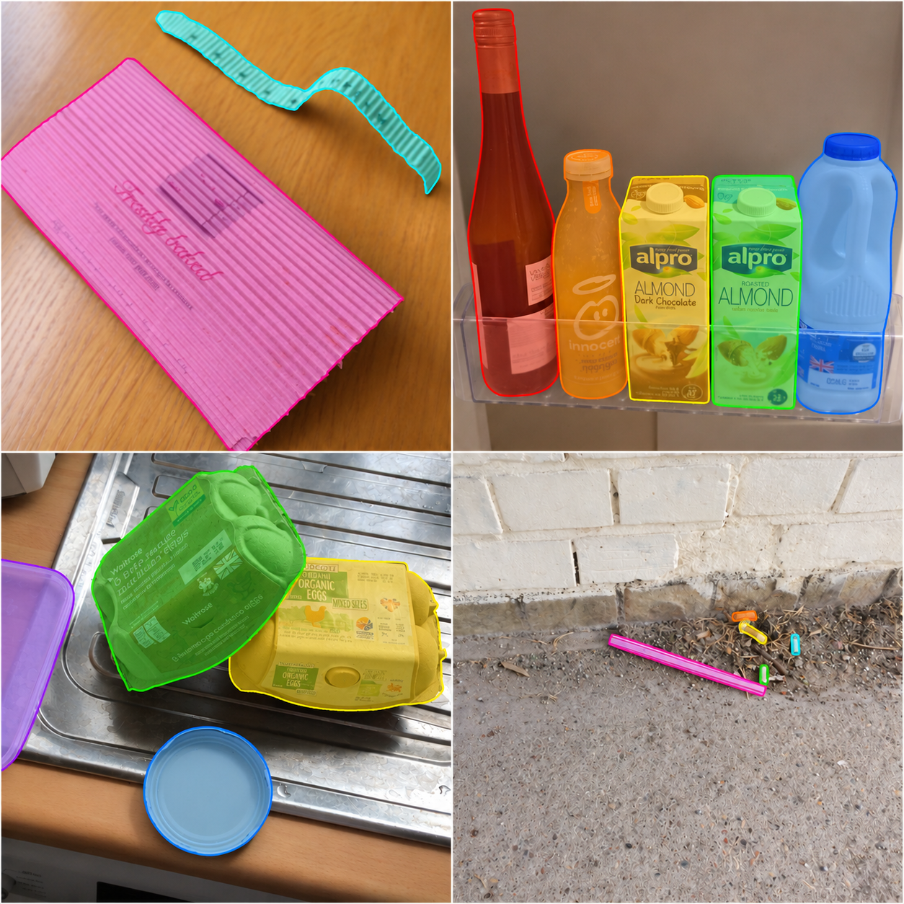
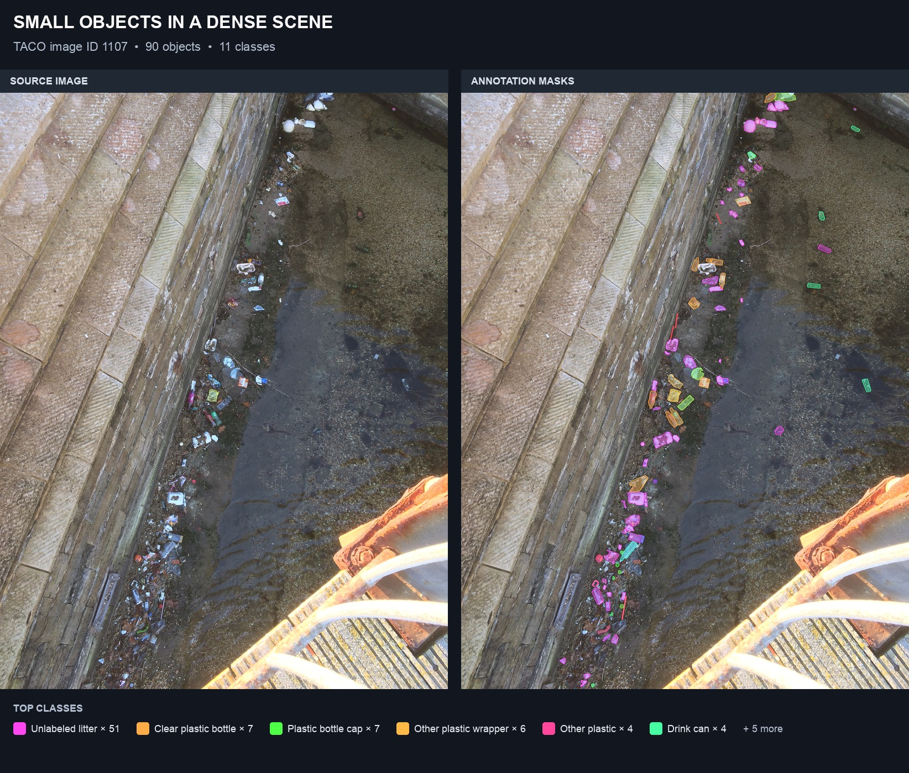
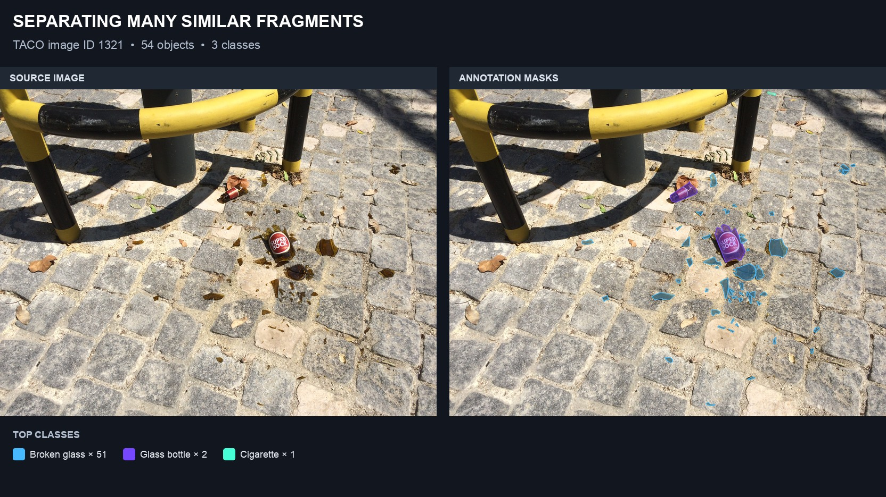
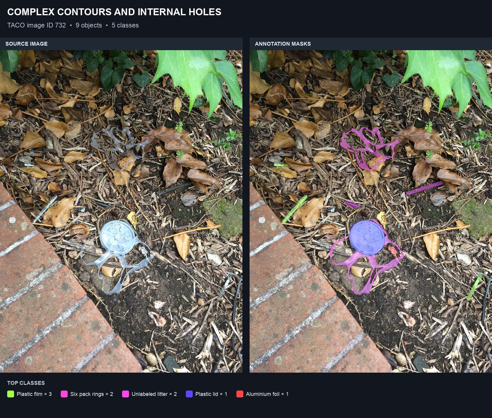
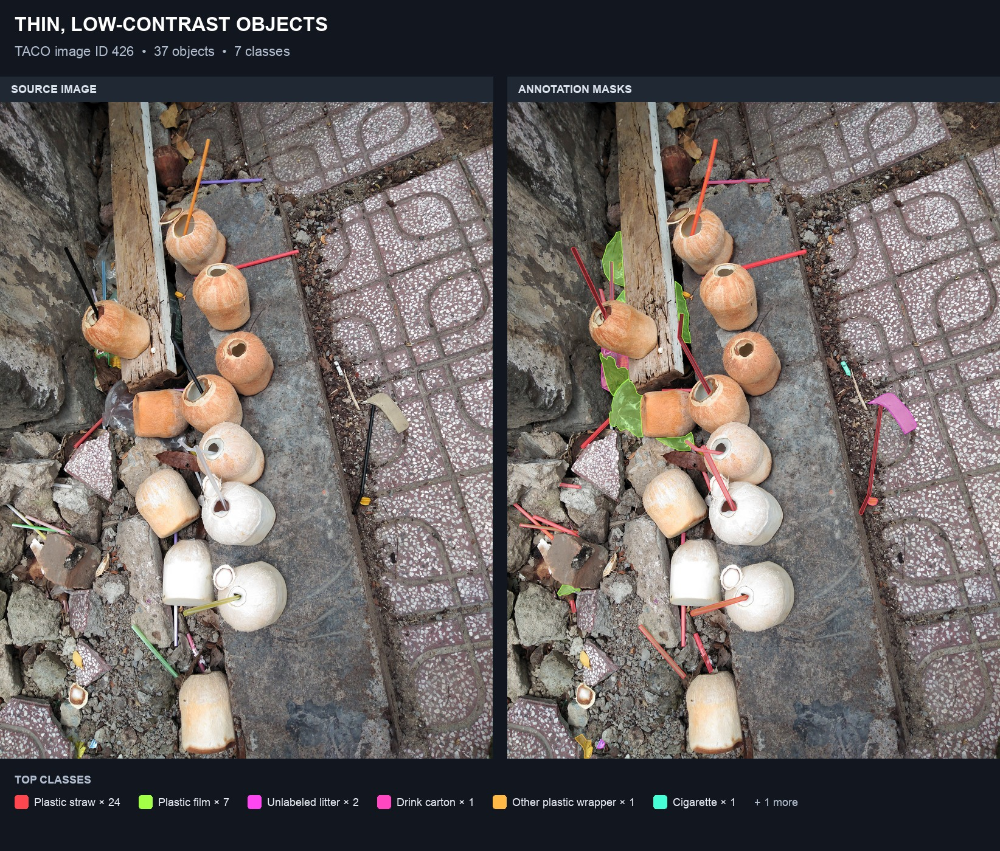

---
keywords:
  - instance segmentation annotation service
  - image segmentation outsourcing
  - data annotation quality assurance
  - instance segmentation annotation cost
  - managed data annotation service
  - taco dataset
description: >-
  How Supervisely combines managed annotation, multi-stage QA, and
  project-specific automation to deliver a production-ready instance
  segmentation dataset.
---

# Beyond Annotation: How Supervisely Builds a Production-Ready Instance Segmentation Dataset

Imagine an ML team developing a model to detect and segment litter in real-world scenes. Training the model will require annotations for thousands or tens of thousands of images, not merely a few hundred. At this scale, the client needs more than a one-time collection of masks: they need a stable production process with consistent rules, predictable throughput, quality control, and a clear budget.

The main risk in a large project is not drawing the polygons themselves. If the initial guidelines do not define how to handle small, occluded, truncated, or ambiguous objects, different interpretations can quickly become thousands of inconsistent annotations and expensive rework. The client may also have to recruit and train annotators, distribute tasks, answer recurring questions, and inspect the results.

Supervisely Annotation Service takes ownership of the operational workflow from end to end. We test the task definition on a calibration batch, identify missing rules and edge cases, help turn the guidelines into production-ready instructions, estimate timeline and cost, and then assign a team that works only with that project's data and rules during production. A stable team retains project context, avoids switching between unrelated requirements, and becomes faster and more consistent over time.

But Supervisely is more than an annotation workforce. Annotators, reviewers, project managers, computer vision engineers, and platform developers work as one team. When calibration reveals a repetitive bottleneck, we can configure existing [AI-assisted tools](../../labeling/labeling-with-AI/overview.md) or build a [project-specific app](https://developer.supervisely.com/), model integration, validator, or workflow instead of asking people to repeat the same manual action thousands of times.

In this article, we reproduce that workflow on 5,000 images from the public [TACO dataset](https://datasetninja.com/taco). The project covers the complete cycle: calibration on 20 images, alignment on difficult cases, project-specific automation, production annotation, QA, and final delivery. The goal is to show how domain decisions, human expertise, and engineering work come together between uploading raw data and receiving an approved dataset.

> **Demonstration project:** The images come from a public dataset rather than a commercial client. The workflow, roles, measurements, and deliverables are designed to represent a real managed annotation project.

## From problem to solution: why clients choose our service

The client retains control over business and domain decisions without having to build and manage annotation production day to day.

| Client problem                                                               | What Supervisely Annotation Service takes on                                                                                                                 | Practical result                                                                                    |
| ---------------------------------------------------------------------------- | ------------------------------------------------------------------------------------------------------------------------------------------------------------ | --------------------------------------------------------------------------------------------------- |
| The guidelines are incomplete or exist only as a high-level task description | A specialist tests the requirements on a calibration batch of 20 images, collects questions, and helps convert the client's decisions into operational rules | Ambiguities are resolved before large-scale annotation rather than after thousands of errors appear |
| The project timeline and budget are unknown                                  | We measure the calibration batch and account for object count, mask complexity, classes, and QA coverage                                                     | The client receives a proposal based on their project data rather than an abstract per-image price  |
| There is no trained team or capacity to recruit, onboard, and coordinate one | After project approval, we assign annotators, a reviewer, and a project manager trained on the specific guidelines                                           | The client works with one accountable team instead of managing individual contributors              |
| Different people may interpret the rules differently at scale                | A stable team works only with the project's data and guidelines during production, while new cases are documented and resolved centrally                     | Annotation variability and rework decrease while first-pass acceptance improves                     |
| Throughput must increase without sacrificing quality                         | The project manager plans capacity, and QA, corrections, and re-review are built into production                                                             | The project scales in a controlled way instead of postponing quality checks until the end           |
| Standard labeling tools do not fit the project's specifics                   | Engineers analyze repetitive work and configure or build project-specific pre-annotation, validation, and routing tools                                      | Less manual work, fewer preventable errors, and a workflow that can be reused on the next batch      |
| The client needs a usable dataset, not access to a tool                      | We configure the project, monitor progress, validate the data structure, prepare the requested export, and provide a QA report                               | The client receives an approved dataset, finalized guidelines, and transparent quality metrics      |

## Project at a glance

| Project parameter  | Result                                                       |
| ------------------ | ------------------------------------------------------------ |
| Task               | Instance segmentation of litter objects in real-world scenes |
| Project scale      | 5,000 images                                                 |
| Annotation classes | 60 classes                                                   |
| Objects annotated  | Approximately 300,000 instances                              |
| Objects per image  | 30–100                                                       |
| Team               | 5 annotators, 2 QA reviewers, 1 project manager              |
| Engineering support | CV/ML engineers and platform developers                      |
| Calibration        | 20 images                                                    |
| Custom automation  | AI mask proposals, dense-scene workflow, automated validators |

**What was delivered:** approved instance masks, the agreed class taxonomy, final annotation guidelines, a QA report, and the dataset in Supervisely and COCO Instance Segmentation formats.

## The annotation request

The hypothetical client needs pixel-level masks for visible litter objects in outdoor and indoor scenes. The data contains small objects, irregular shapes, partial occlusions, visually similar materials, and objects whose boundaries may blend into the background.

The request appears straightforward: select the correct class and draw a mask around every relevant object. In practice, a production-ready specification also needs to answer questions such as:

- Which objects count as litter and which belong to the background?
- How should partially hidden or damaged objects be annotated?
- Should disconnected parts of the same object form one instance or several?
- How precisely should annotators follow an unclear or blurred boundary?
- What happens when the material is visible but the exact object class is uncertain?
- Which objects are too small or ambiguous to annotate reliably?

These decisions affect quality, annotation speed, and price. Resolving them before estimating the project and starting production is one of the main responsibilities of the annotation service.

## How the managed annotation process works

The project follows six stages. First, one specialist tests the initial requirements on a small calibration batch and collects open questions. The same batch is used to find repetitive actions worth automating. After edge cases are aligned with the client, the team finalizes the guidelines, designs the automation layer, and produces an evidence-based estimate of timeline and cost. Once the commercial proposal is approved, a project manager coordinates production, engineers support the workflow, and reviewers verify the output against the finalized guidelines.

| Stage                                                     | What the service and client do                                                                                                                                                | What the client can review                                     | Output                                    |
| --------------------------------------------------------- | ----------------------------------------------------------------------------------------------------------------------------------------------------------------------------- | -------------------------------------------------------------- | ----------------------------------------- |
| 1. Initial assessment                                     | Reviews the data, objective, taxonomy, existing guidelines, output format, and acceptance criteria                                                                            | Preliminary scope and open questions                           | Draft brief and calibration plan          |
| 2. Calibration batch                                      | One specialist selects, reviews, and annotates 20 images covering the main data types and edge cases                                                                          | Annotated examples, ambiguities, and questions                 | Calibration annotations and question list |
| 3. Alignment, guidelines, automation design, and estimate | Reviews ambiguous cases with the client, records decisions, selects automation opportunities, and calculates effort, timeline, QA, and cost                                  | Edge cases, final guidelines, automation plan, assumptions, and calculation | Estimate and production plan              |
| 4. Production                                             | Annotates the remaining images using agreed rules, AI-assisted tools, and project-specific workflow improvements                                                             | Project progress, automation performance, and interim samples  | First-pass annotations                    |
| 5. QA and correction                                      | Runs automated validators, reviews annotations, records issues, returns errors for correction, and approves the final result                                                  | QA report, corrected examples, acceptance metrics              | Approved annotations                      |
| 6. Delivery                                               | Validates project structure, exports the data, and documents reusable automation                                                                                             | Final delivery summary                                         | Dataset, guidelines, QA report, and automation package |

## 1. Turning the request into an annotation specification

Before drawing the first mask, the project manager and annotation lead review the source data and convert the initial request into operational instructions. This step defines what “correct” means for this particular project.

For the TACO sample, the draft specification covered:

- the taxonomy and annotation rules;
- mask and QA requirements;
- the delivery format and automation opportunities.

The first version is intentionally treated as a draft. Real ambiguities usually become visible only after a specialist applies the rules to the calibration images. The guidelines are finalized after these cases have been discussed with the client.

## 2. Selecting a representative project sample

A useful calibration batch should reflect the difficulty of the production data. From the complete set of 5,000 images, we selected 20 images covering the main data types and anticipated edge cases. Selecting only clean, easy images would have produced misleading estimates for speed and cost.

The demonstration subset therefore included:

- images with different numbers and sizes of objects;
- clear and ambiguous classes and boundaries;
- visible, occluded, and truncated objects against varied backgrounds.

Each image received an internal complexity label: **easy**, **medium**, or **hard**. These groups helped explain differences in annotation time and cost and let the engineering team benchmark automation on simple and difficult scenes separately.

The annotated collage below shows four different scenes from the calibration sample without repeating the edge-case examples used later in the article.

<figure></figure>

## Project-specific automation for litter annotation

Calibration showed that the main bottlenecks were repeated mask creation, dense scenes with dozens of tiny objects, and preventable geometry errors. Instead of treating them only as staffing problems, the Supervisely engineering team designed an automation layer for this project:

1. **AI-assisted mask proposals.** [Supervisely Smart Tool](../../labeling/labeling-tools/smart-tool.md) and a project-specific segmentation model create an initial mask from a click or rough box. The annotator remains responsible for the class, boundary, and final acceptance.
2. **Dense-scene workflow.** Images with many small objects are split into overlapping regions of interest and routed through a focused review sequence. This reduces visual search and helps prevent tiny fragments from being missed.
3. **Automated validation and routing.** Before submission, project rules flag duplicate or overlapping instances, invalid masks, unusual object counts, and classes that require closer review. Dense images and rare classes are automatically routed to experienced annotators or expanded QA.

Automation is introduced only after it is tested on the calibration batch. If a model suggestion takes longer to correct than a manual mask, the team changes the tool or keeps that case manual. The goal is not to remove human judgment, but to spend it where it has the most value.

## Edge-case examples from TACO

The four images below were selected from the complete TACO dataset using different measurable indicators of annotation difficulty. They illustrate the questions a specialist should discover during calibration and align with the client before preparing an estimate.

### Edge case 1: many very small objects

<figure></figure>

This image contains **90 annotated objects across 11 classes**. Every object occupies less than 0.1% of the frame, and 59 occupy less than 0.02%. Calibration must define a minimum object size, completeness requirements, and a policy for objects whose exact class cannot be determined visually. The dense-scene workflow can divide the frame into manageable regions and track which regions have already been reviewed.

**Question for the client:** should every visible fragment be annotated regardless of size, or should objects below an agreed threshold be skipped?

### Edge case 2: separating many similar fragments

<figure></figure>

The image contains **54 objects**, including 51 broken-glass fragments; 50 objects occupy less than 0.1% of the image. The main ambiguity is not one mask boundary but instance definition: whether every shard is a separate object and how nearly touching fragments should be handled. A validator can flag overlapping or duplicate masks, but the separation rule remains a client and human decision.

**Question for the client:** should every physically separate shard be its own instance, or may nearby fragments be grouped according to an agreed rule?

### Edge case 3: a complex contour and internal holes

<figure></figure>

One object in this image is represented by a polygon with **543 vertices**. The six-pack ring contains narrow connectors, internal holes, and areas partially hidden by leaves. This example helps define the required mask precision and whether internal holes must be preserved. AI-assisted segmentation can create the first contour, while the annotator checks holes and thin connectors before acceptance.

**Question for the client:** must masks follow every hole and thin connector precisely, or is simplified geometry acceptable within a defined tolerance?

### Edge case 4: thin, low-contrast objects

<figure></figure>

The scene contains **37 objects across seven classes**, including 24 plastic straws; 28 objects occupy less than 0.1% of the image. Thin objects partially blend into the textured background, and some are visible only as fragments. If the model produces an unstable proposal, the workflow automatically falls back to manual annotation rather than forcing an inaccurate mask.

**Question for the client:** what minimum thickness and visibility are sufficient for annotation, and how should a fragment be handled when it cannot be confidently linked to a complete object?

Together, these images form a useful calibration batch: they expose different types of uncertainty and reveal which rules are missing from the initial guidelines before production begins.

## 3. Running calibration and aligning edge cases with the client

During calibration, one annotation specialist tested the initial requirements on 20 images selected to cover the main data types and as many anticipated edge cases as possible.

The purpose is not to compare multiple annotators. It is to identify everything that is still undefined in the guidelines and may affect the project scope. The specialist records questions about object inclusion, classes, mask boundaries, and other ambiguities, while an engineer identifies repetitive actions and tests whether AI assistance or a custom validator saves time without reducing quality.

After the discussion, the client completes the guidelines if the original rules did not cover every case. We verify that the agreed decisions are captured and can be applied consistently. Only then do we estimate annotation complexity and speed, select the automation that passed calibration, define the QA approach, and confirm the project timeline and cost.

## 4. Annotating the production batch

After calibration, guideline finalization, and approval of the commercial proposal, the team annotates the remaining images. Eligible objects receive AI-assisted mask proposals; annotators verify every suggestion and handle ambiguous cases manually. Automated validators run before submission, while dense or unusual images are routed to the right specialist.

The project manager monitors progress and quality, while engineers watch how the automation performs on real batches. If corrections reveal a repeated failure pattern, the team updates the model settings, validator, or workflow for the next batch. The production process improves during the project instead of remaining fixed from day one.

## 5. Reviewing quality and correcting errors

Quality control has three layers: automated validation, annotation review, and final QA.

Project-specific validators run before human review. They do not decide whether an annotation is semantically correct, but they catch preventable issues such as duplicate instances, invalid masks, suspicious overlaps, and project-rule violations. This lets reviewers spend more time on class decisions, completeness, and boundary quality.

First, reviewers inspect all completed annotations against the agreed guidelines. They look for missing or extra objects, incorrect classes, inaccurate boundaries, and instance-separation errors. Tasks with issues are returned to annotators with comments and reviewed again after correction. In this project, **6% of tasks** were returned at this stage.

After review, approved tasks undergo independent QA by a senior reviewer. The review percentage is agreed with the client; in this project, it covers **25% of each batch**. The QA process follows these principles:

- the sample includes work from every annotator, all classes, and different complexity levels;
- difficult images and rare classes are reviewed more frequently;
- a critical error triggers the return of the related batch;
- if an error repeats, the sample is expanded and previously approved tasks are rechecked;
- the result is approved only after all critical and systematic issues are corrected.

After final QA, the repeat-return rate was **2%**.

## How we measured annotation quality

Annotation quality is evaluated across several metrics: object completeness, class and mask accuracy, and review outcomes.

| Quality metric               | What it answers                                                | Final result              |
| ---------------------------- | -------------------------------------------------------------- | ------------------------- |
| Object completeness / recall | Were required objects missed?                                  | 99.5%                     |
| Class agreement              | Were objects assigned to the expected classes?                 | 99.7%                     |
| Mask overlap / IoU           | How closely do approved masks match the adjudicated reference? | 0.95                      |
| First-pass acceptance rate   | How much work passed review without correction?                | 94%                       |
| Correction rate              | How much work required at least one change?                    | 6%                        |
| Critical-error count         | Did any issues prevent the data from being usable?             | 0 after final QA          |
| Review coverage              | What portion of the project was inspected?                     | 100% review; 25% final QA |

The reference annotations already available in TACO can support comparison, but they should not automatically be treated as unquestionable ground truth. Where our approved result and the source annotation differ, the annotation lead will review the case and record whether it is a service error, an acceptable alternative boundary, or a difference in the project rules.

## How long the project took

The project took **15 working days**. Total effort, including setup, annotation, review, and corrections, was **500 person-hours**.

| Work stage                       |                Time | How it was measured                                                                                |
| -------------------------------- | ------------------: | -------------------------------------------------------------------------------------------------- |
| Scope and solution design        |             4 hours | Project manager, annotation lead, and engineering assessment                                        |
| Guidelines and automation plan   |             4 hours | Written rules, visual examples, validator logic, and AI-assistance configuration                    |
| Calibration                      |             2 hours | Batch annotation, automation benchmark, question collection, client discussion, and final review    |
| Estimate and commercial proposal |             4 hours | Calculation of effort, timeline, QA, and cost based on calibration evidence                        |
| Production annotation            |           420 hours | Active annotation time for five annotators                                                         |
| QA and corrections               |            64 hours | Review, rework, and final acceptance                                                               |
| Export and delivery              |             2 hours | Validation and packaging                                                                           |
| **Total effort**                 |     **500 hours** | Total active time across the team                                                                  |
| **Total turnaround time**        | **15 working days** | From approved scope to final delivery                                                              |

Five annotators worked in parallel, while review and QA were performed as batches were completed. As a result, the calendar timeline is shorter than the team's combined effort.

## From calibration on 20 images to a 5,000-image project

The project began with a calibration batch of 20 images. A specialist used it to validate the 60-class taxonomy and clarify rules for difficult cases, while engineers used the same batch to benchmark AI-assisted masks and define automated checks. Calibration took up to two hours and produced consistent instructions and an automation plan for the whole team.

Once the rules and automation were agreed, five annotators began production, two reviewers checked completed batches, a project manager coordinated the workflow, and engineers supported the project-specific tools. The team processed 5,000 images containing 30–100 objects each and annotated approximately 300,000 objects.

All annotations were reviewed, and 25% of the tasks in each batch underwent additional final QA. The project took 15 working days: 420 hours of production annotation and 500 person-hours including setup, review, and corrections.

## What the client receives

At the end of the project, the client receives a ready-to-use dataset and a complete set of supporting materials:

- 5,000 images with approved instance segmentation annotations;
- approximately 300,000 annotated objects across 60 classes;
- the final taxonomy and annotation guidelines;
- the configured AI-assisted workflow and automated validation rules;
- a QA report covering review, corrections, and final verification;
- final quality and productivity metrics;
- the dataset in Supervisely and COCO Instance Segmentation formats.

## What this project demonstrates

This project shows how a managed annotation service scales an instance segmentation task from a small calibration batch to a ready-to-use dataset:

1. **Calibration reduces uncertainty.** A 20-image batch helped refine the rules for 60 classes before production began.
2. **The team can handle production scale.** Five annotators, two reviewers, and a project manager processed 5,000 images and approximately 300,000 objects in 15 working days.
3. **Quality is controlled at multiple levels.** All annotations were reviewed, 25% of tasks underwent final QA, object recall reached 99.5%, class agreement reached 99.7%, and IoU reached 0.95.
4. **Engineering makes the workflow more efficient.** AI-assisted masks reduce repetitive contour work, the dense-scene workflow helps prevent omissions, and validators catch mechanical errors before human review.

The result is more than access to platform tools: it includes agreed rules, coordinated production, project-specific automation, multi-level quality control, and a dataset ready for use.

## Conclusion: not just outsourced annotation

A strong annotation service should not simply add more hands to a difficult workflow. It should understand the data, decide where human judgment is essential, and engineer away repetitive work that does not require that judgment. This is the advantage of working with the whole Supervisely team rather than a standalone annotation workforce.

The client leaves with more than one completed batch. They receive a reusable production system: guidelines, trained specialists, QA rules, automation components, and a dataset structure that can be applied to the next delivery. As new batches arrive, the workflow can be refined with corrected annotations, new validators, and better project-specific models—so the process becomes faster and more consistent over time.

## Project results

| Metric                       | Result                                                  |
| ---------------------------- | ------------------------------------------------------- |
| Calibration time             | 2 hours                                                 |
| Average annotation time      | Approximately 5 minutes per image                       |
| Production annotation effort | 420 hours                                               |
| Total project effort         | 500 person-hours                                        |
| Project-specific automation  | AI mask proposals, dense-scene workflow, validators     |
| Annotation budget            | €2,100                                                  |

## Request an estimate for your own data

If you are planning a data annotation project, send us a representative sample and a short description of the task. Our annotation and engineering teams will review the data, identify what should remain human-led and what can be automated safely, and propose a suitable workflow, QA plan, timeline, and cost.

**[Request an annotation project estimate →](https://supervisely.com/contact-us)**
