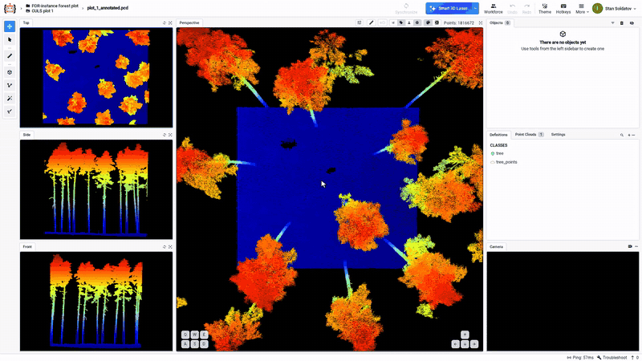
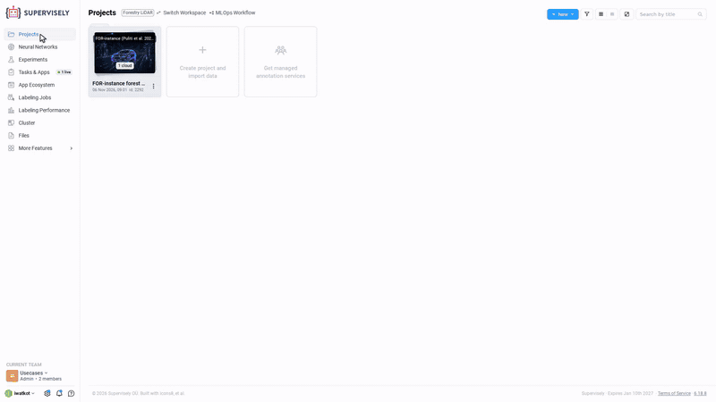
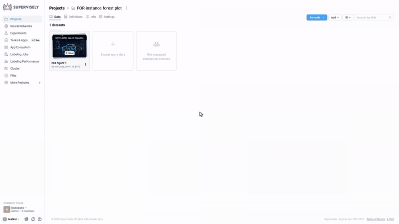
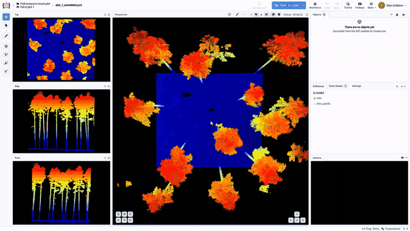
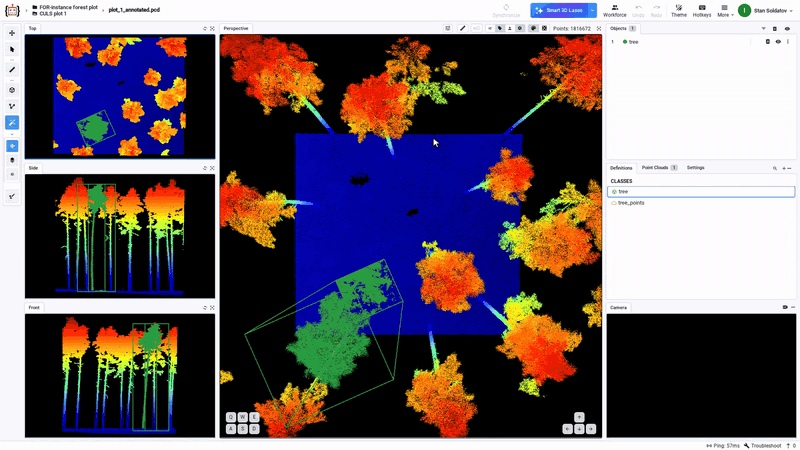
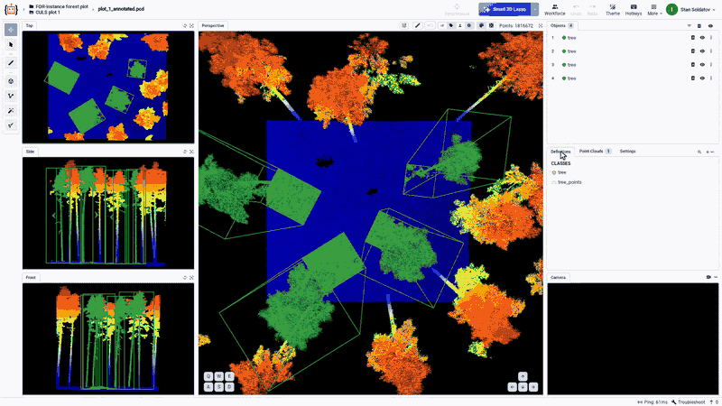

---
keywords:
  - forest lidar annotation
  - tree detection point cloud
  - uav lidar labeling
  - 3d cuboid annotation
  - ai point cloud labeling
  - forest inventory lidar
  - individual tree segmentation
  - las point cloud labeling
  - FOR-instance dataset
description: >-
  Forest LiDAR in Supervisely: add a FOR-instance sample plot, fit a 3D cuboid
  to each tree with the 3D AI Assistant, then adjust it by hand.
---

# Label Trees in Forest LiDAR with AI 3D Cuboids

## Forest LiDAR in the real world

Here is an example of a forest point cloud: plot 1 of the CULS site in [FOR-instance](https://arxiv.org/abs/2309.01279) (Puliti et al., 2023), a UAV laser scan of a forest stand in the Czech Republic. It holds 1,816,672 points over about 28 × 32 m, with a canopy about 29 m tall. Coloured by height, the ground is blue, the stems turn green and yellow, and the crowns are red.

<figure><figcaption>
FOR-instance, CULS plot 1. Data: Puliti et al. 2023, CC BY 4.0.
</figcaption></figure>

Laser scans like this one are used across forestry:

* **Forest inventory.** Airborne laser scanning is a standard source for strategic, tactical and operational forest inventories ([White et al., 2016](https://doi.org/10.1080/07038992.2016.1207484)). Scanners on UAVs give much denser clouds, up to 62 points per m² in [Wallace et al. (2012)](https://doi.org/10.3390/rs4061519), dense enough to see single trees.
* **Individual trees and their height.** Methods that find each tree in an airborne laser scan and measure its height were compared against field data in an international test by EuroSDR and ISPRS ([Kaartinen et al., 2012](https://doi.org/10.3390/rs4040950)).
* **Biomass.** The aboveground biomass of single trees can be estimated from terrestrial and UAV laser scans ([Brede et al., 2022](https://doi.org/10.1016/j.rse.2022.113180)).
* **Species.** Tree species classification is benchmarked on more than 20,000 single-tree point clouds of 33 species in [FOR-species20K](https://arxiv.org/abs/2408.06507) (Puliti et al., 2024).

Each of these needs trees labeled one by one, to train and to check the models. FOR-instance itself was built for that: five UAV laser scanning collections from different forest types, with every tree segmented by hand ([dataset on Zenodo](https://doi.org/10.5281/zenodo.8287792)).

## What Supervisely covers

Supervisely holds the whole path from a raw scan to a labeled dataset:

* **Storing and viewing dense clouds.** The [3D point cloud editor](../labeling/3D-Point-Clouds/3D-point-cloud-episodes-2/README.md) shows a cloud in four views and handles up to 50 million points per frame.
* **Labeling trees** as 3D cuboids (position, size and heading of each tree) or as [point masks](#point-masks-for-segmentation) drawn with the Point Cloud Pen (the tree's own points, for segmentation).
* **AI-placed cuboids.** The [3D AI Assistant](../labeling/labeling-with-AI/3d-point-clouds/README.md#3d-ai-assistant) places a cuboid around a tree from one circle drawn around its crown, instead of a box fitted edge by edge by hand.
* **Teamwork and review** with [labeling jobs](../labeling/jobs/README.md), [export](../data-organization/import/export/export.md) in Supervisely format, and training 3D detectors with [Train MMDetection3D](https://ecosystem.supervisely.com/apps/mmdetection3d-v1.x/supervisely-train).

## Import the data

### The sample project

The plot above is a ready Supervisely project in the Ecosystem: [Forest LiDAR Tree Annotation (FOR-instance CULS plot)](https://ecosystem.supervisely.com/projects/forest-lidar-tree-annotation). It is the way to try everything on this page without data of one's own. It holds one point cloud, CULS plot 1 converted from LAS to PCD and recentred to the origin, and two classes: `tree` (Cuboid) and `tree_points` (Point Cloud), with no labels. The data comes from FOR-instance by Puliti et al. (2023), [Zenodo record 8287792](https://doi.org/10.5281/zenodo.8287792), under [CC BY 4.0](https://creativecommons.org/licenses/by/4.0/).

To add it, open **App Ecosystem**, search for the sample, hover its card and click **GET PROJECT**. The project goes into the current team and workspace under the name given in the dialog. The copy runs as a task, and its output links to the new project.

<figure><figcaption>
Adding the sample project (the wait for the task is cut).
</figcaption></figure>

### Other ways in

A project's **Add** menu opens **Import data**:

* **Quick Auto Import** takes `.pcd`, `.ply`, `.las` and `.laz` files by drag and drop. LAS and LAZ load without conversion: see [.PCD, .PLY, .LAS, .LAZ pointclouds](../data-organization/import/import/supported-formats-pointcloud/point_clouds.md).
* **Apps from Ecosystem** for point clouds: [Import Point Clouds PCD](https://ecosystem.supervisely.com/apps/import-pointcloud-pcd), [Import Point Clouds PLY](https://ecosystem.supervisely.com/apps/import-pointcloud-ply), [Import LAS/LAZ format](https://ecosystem.supervisely.com/apps/import-las-format), [Import Point Cloud Project](https://ecosystem.supervisely.com/apps/import-pointcloud-project) and [Import KITTI 3D](https://ecosystem.supervisely.com/apps/import-kitti-3d).
* **Cloud Storage**: data in a cloud bucket (AWS S3, Google Cloud Storage, Azure) can be linked to Supervisely instead of uploaded, so it is not duplicated. See [Import from Cloud](../data-organization/import/import/import-from-cloud.md).
* **Command line interface (CLI)**, **Python** and the **API**, for imports from code: see the [Developer Portal](https://developer.supervisely.com/).

<figure><figcaption>
Import to Project: upload, apps, cloud storage and code.
</figcaption></figure>

Large map (UTM) coordinates, as in the original FOR-instance files, can open the view off-centre. The sample's cloud is recentred for that reason.

## The 3D point cloud editor

The editor is described in [3D Point Cloud and Episodes](../labeling/3D-Point-Clouds/3D-point-cloud-episodes-2/README.md), with its [navigation](../labeling/3D-Point-Clouds/3D-point-cloud-episodes-2/README.md#navigation-behavior), [layout](../labeling/3D-Point-Clouds/3D-point-cloud-episodes-2/README.md#modular-and-resizable-ui-layout) and [hotkeys](../labeling/3D-Point-Clouds/3D-point-cloud-episodes-2/README.md#hotkeys). Dense clouds render with WebGPU: see [Performance Upgrade for Dense Clouds](../labeling/3D-Point-Clouds/3D-point-cloud-episodes-2/3D-point-cloud-optimizations.md). For a forest plot, these parts matter.

**The views.** **Top**, **Side** and **Front** are projections on the left; **Perspective** in the middle shows the cloud in 3D. Dragging the border between two views resizes them, so a projection can take most of the screen when it is the one in use. In the Perspective view, with the Move tool (`1`), a left-drag orbits, a right-drag pans and the wheel zooms.

<figure><figcaption>
The four views, resizing, and moving around the stand (1.25× speed).
</figcaption></figure>

**The settings.** The **Settings** tab next to **Definitions** holds what changes the look of a forest scan:

* **Perspective, points size** (under **CLOUD POINTS**): larger points make crowns read denser.
* **Color mode**, **Z-coord (height)**: the ground blue, the crowns red.
* **Zoom to object** (under **USER INTERFACE**): when on, the views jump to each new or selected object. Off, the views stay where they are, which suits labeling many trees in a row.

<figure><figcaption>
Points size, colour by height and Zoom to object (1.25× speed).
</figcaption></figure>

## AI-placed cuboids with the 3D AI Assistant

The [3D AI Assistant](https://ecosystem.supervisely.com/apps/3d-ai-assistant) is class-agnostic: it was not trained on trees and needs no fine-tuning to fit a cuboid around one. It runs as an app on a GPU agent of the team; the editor's AI tools use it while it runs.

**Smart Lasso 3D Object Detection** is in the menu next to **Smart 3D Lasso** in the top bar. With the class `tree` selected, one circle drawn around a crown in the Top view gives a cuboid around the whole tree, from the ground to the treetop. Here the first tree's cuboid is 25.84 m high and 7.40 × 5.89 m across.

<figure><figcaption>
One circle, one tree (1.25× speed).
</figcaption></figure>

`Space` starts the next object, so the plot is labeled tree after tree: a circle, `Space`, the next circle. With **Zoom to object** off the views stay put; switched on, they jump to each new cuboid.

<figure><figcaption>
Tree after tree, then the same with Zoom to object on.
</figcaption></figure>

**The AI does the bulk, the person corrects.** Selecting a cuboid in the **Objects** list turns the Top view to the cuboid's axes and shows handles on its edges. Here the third tree's box has a margin of about a metre past one side of the crown. Dragging that edge in until crown points show outside the box, then back out just past them, brings the side from 7.49 m to 6.44 m. The change saves at once. Checked against the dataset's own tree labels, all 85,626 points of that tree are still inside the box. The same assistant can also fit a cuboid drawn by hand: see [Automatic Cuboid Adjustment](../labeling/3D-Point-Clouds/3D-point-cloud-episodes-2/README.md#3d-ai-assistant).

<figure><figcaption>
Fitting one edge to the crown by hand (the drags at 4× speed, the rest at 1.25× to 2×).
</figcaption></figure>

## Point masks for segmentation

A cuboid gives a tree's position and size. Segmentation and species models need more: each tree's own points. The [Point Cloud Pen](../labeling/3D-Point-Clouds/3D-point-cloud-episodes-2/README.md#3d-point-cloud-pen) (`5`) labels them as a point mask, here of one standing tree with the class `tree_points` (Point Cloud).

The scene is empty for this: no cuboids, so the mask does not mix with a box (the trash button in the **Objects** panel removes all objects), and **Zoom to object** is off, so the views stay put when the new mask is selected. Each step works in one projection made big by dragging the borders between the views, so every click lands where it is meant to.

* **The crown, in the Top view.** With the Top view enlarged, the tree is dragged to the middle and zoomed in; the wheel zooms on the middle of the view. Clicks around the whole crown, a little outside its edge, and a click on the first point close the outline. The mask saves at once, in orange. An outline drawn from above takes every point under it, the ground included.
* **The ground, in the Side view.** With the Side view enlarged and zoomed in close on the ground band, an outline drawn with `Shift` held takes points out of the mask. Its top edge follows the top of the ground band and steps down around the stem. Under this tree the stem starts at about 1.0 m and the ground points reach 1.2 m, so a straight cut would either leave ground in the mask or cut off the foot of the stem.

Checked against the dataset's own tree labels, the mask holds all 85,626 points of the tree, and only 677 of the 51,773 ground points under the crown outline stay in it, next to the foot of the stem. The clip runs from the empty scene to the finished mask, the whole tree from the foot of the stem to the top.

<figure><figcaption>
Big Top view for the outline, big Side view for the ground cut (1.75× speed).
</figcaption></figure>

## From labeled trees to forest data

Back to the uses this data serves:

* **Inventory**: one cuboid per tree gives the tree count and the position of each tree in the plot.
* **Height and crown size**: each cuboid carries the tree's height and crown width, the measurements biomass models start from.
* **Species and segmentation models**: labeled trees are training data. Where a model needs each tree's own points rather than a box, the [point masks](#point-masks-for-segmentation) drawn with the Point Cloud Pen give them: the crown outlined from above, the ground cut away from the side, the whole tree from the foot of the stem to the top.

What it speeds up is the fitting: one circle and a check in place of a box built edge by edge for every tree.

Next steps:

* Split plots among a team with [labeling jobs](../labeling/jobs/README.md).
* [Export](../data-organization/import/export/export.md) the labels in Supervisely format, for example with [Export Point Clouds Project in Supervisely Format](https://ecosystem.supervisely.com/apps/export-pointclouds-project-in-supervisely-format).
* Train a 3D detector with [Train MMDetection3D](https://ecosystem.supervisely.com/apps/mmdetection3d-v1.x/supervisely-train).
* Automate imports, labeling and export with the [Python SDK and API](https://developer.supervisely.com/).
