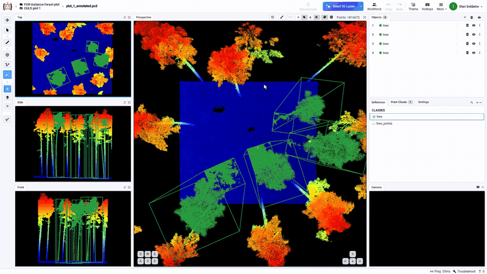
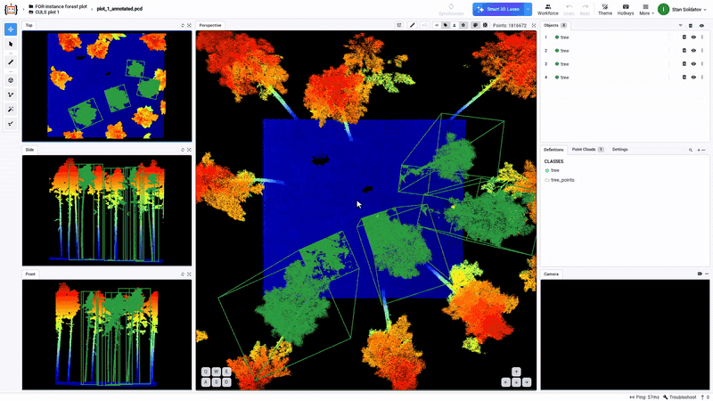
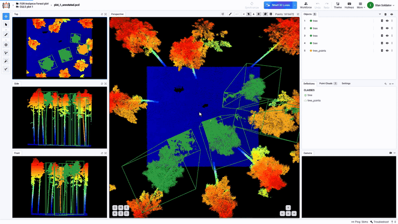

---
keywords:
  - forest lidar annotation
  - tree detection point cloud
  - uav lidar labeling
  - 3d cuboid annotation
  - ai point cloud labeling
  - individual tree segmentation
  - las point cloud labeling
  - forestry 3d annotation
  - FOR-instance dataset
description: >-
  Open a UAV LiDAR forest plot in Supervisely, fit a 3D cuboid to each tree with
  AI Smart Lasso, fix touching crowns by hand and check tree height.
---

# Label Trees in Forest LiDAR with AI 3D Cuboids

## What you will do

You open a UAV LiDAR scan of a forest plot in the 3D point cloud labeling tool and look around the stand. Then you label trees: the AI fits a 3D cuboid to a whole tree, from the ground to the treetop, after you circle its crown once, with **Zoom to object** off so the views stay put. Where two crowns touch, you outline the tree point by point with the Point Cloud Pen and cut out the ground and the neighbour's branches. Last, you measure a tree's height with the ruler and compare it with its cuboid.

The plot has 1.8 million points, about 28 × 32 m, with trees up to about 29 m tall.

## Before you start

* A Supervisely account and a point cloud project.
* The data: one plot from **FOR-instance** (Puliti et al. 2023), a benchmark of UAV laser scans with hand-segmented trees. Download it from [Zenodo](https://zenodo.org/records/8287792); the paper is on [arXiv](https://arxiv.org/abs/2309.01279). The dataset is licensed under [CC BY 4.0](https://creativecommons.org/licenses/by/4.0/). This page uses the CULS plot 1 (a Riegl UAV scan from the Czech Republic).
* Two classes in the project:
  * `tree` with the **Cuboid** shape, for the AI fit;
  * `tree_points` with the **Point Cloud** shape, for masks drawn by hand.
* The [3D AI assistant](https://ecosystem.supervisely.com/apps/3d-ai-assistant) app running on a GPU agent in your team. Without it, Smart Lasso says **AI Engine is not running**.
* A browser with WebGPU, for example Chrome or Edge 113 or newer. The tool renders dense clouds with WebGPU: see [Performance Upgrade for Dense Clouds](../labeling/3D-Point-Clouds/3D-point-cloud-episodes-2/3D-point-cloud-optimizations.md).

## Bring a forest plot into Supervisely

The import reads `.las`, `.laz`, `.ply` and `.pcd` files: see [.PCD, .PLY, .LAS, .LAZ pointclouds](../data-organization/import/import/supported-formats-pointcloud/point_clouds.md).

FOR-instance plots are stored in large map (UTM) coordinates. For this page the plot was recentred, each axis minus its minimum, and saved as PCD, so the view opens on the plot. A file with large coordinates can open off-centre.

The file's `classification` and `treeID` fields are not imported as labels. This page labels the trees from scratch.

## Open the plot

Open the project, then the dataset, and click the point cloud card. The 3D point cloud labeling tool opens with four views: **Top**, **Side**, **Front** and **Perspective**. The counter above the Perspective view shows that all 1,816,672 points are loaded.

<figure><figcaption>
Opening the plot. Data: FOR-instance, Puliti et al. 2023, CC BY 4.0.
</figcaption></figure>

## Look around the stand

Click the **Perspective** view to make it active. With the Move tool (`1`, the default):

* left-drag to orbit,
* right-drag to pan,
* the mouse wheel to zoom.

Tilt the view to see the stems and the ground under the canopy, then zoom in on a crown.

Dense crowns are easier to read with larger points. Open the **Settings** tab next to **Definitions** and, under **CLOUD POINTS**, raise **Perspective, points size**. **Color mode** stays on **Z-coord (height)**, so the ground is blue and the crowns are red. Go back to the **Definitions** tab.

<figure><figcaption>
Looking around the stand and raising the points size (1.5× speed).
</figcaption></figure>

## Fit a tree with AI

By default the tool moves the camera to every new or selected object. While you fit tree after tree, that jump gets in the way, so turn it off first:

1. Open the **Settings** tab next to **Definitions**, scroll to **USER INTERFACE** and turn off **Zoom to object**. Go back to the **Definitions** tab. The tool keeps this setting in your browser.
2. In the **Definitions** panel, click the class `tree`.
3. Open the arrow next to **Smart 3D Lasso** in the top bar and choose **Smart Lasso 3D Object Detection**.
4. In the **Top** view, press and drag a circle around one crown and release.

About 5 seconds later a cuboid appears and `tree` shows in the **Objects** list. The views stay where they were. The cuboid spans the whole tree, from the ground to the treetop: the Side view shows it as 26.33 m high and 7.36 × 6.38 m wide.

<figure><figcaption>
Zoom to object off, then one circle around the crown gives a cuboid for the whole tree.
</figcaption></figure>

## Fit the next trees

Press `Space` before each new circle to start a new object. If a cuboid is still selected, a circle re-fits that cuboid instead of adding a new one.

Circle the next crowns the same way. With **Zoom to object** off, the views stay put while the AI fits tree after tree. On this plot the next fits were 25.67 m and 25.44 m high. Where crowns touch, the box stops where they meet: the fourth tree, whose crown touches its neighbour, got a 23.99 m cuboid that does not reach into the neighbour.

<figure><figcaption>
Space, circle, repeat: four trees labeled, and the views do not move.
</figcaption></figure>

## See the camera move to a new tree

To see what the setting does, turn **Zoom to object** back on and fit one more tree. When the cuboid appears, the **Perspective** view moves to it and the **Side** and **Front** views re-centre and zoom out on it. That is handy when you check one object at a time. For many fits in a row, keep it off.

<figure><figcaption>
Zoom to object on: the views move to the new tree.
</figcaption></figure>

## Fix touching crowns by hand

Where crowns touch, check the tree by hand and label its points with a mask. Turn **Zoom to object** off again, so the views do not move or zoom out when the new mask is selected.

1. Press `1` for the Move tool. In the **Top** view, drag the touching crown to the middle and zoom in with the mouse wheel, so you can see each point you click.
2. Click the class `tree_points` in the **Definitions** panel. If the class does not change right after Smart Lasso, reload the page first.
3. Press `5` for the **Point Cloud Pen**.
4. **Outline the crown.** In the **Top** view, click around the crown, then click the first point to close the outline. The mask is saved and shows in orange.

An outline drawn from above takes every point under it, ground included. To remove points, hold `Shift` and outline them:

5. **Shift: cut the ground.** In the **Side** view, right-drag the tree's base to the middle and zoom in on the ground band. Hold `Shift`, click the four corners of a thin box around the ground band and its first corner again. The ground leaves the mask.
6. **Shift: cut the neighbour.** In the **Top** view, hold `Shift` and box the neighbour's branches where the crowns meet. The orange mask now stops at the neighbour.

On this tree the mask went from 70,308 points to 51,238 without the ground, and to 48,652 without the neighbour's branches. Zoom out in the **Top** view to see the mask in the plot.

<figure><figcaption>
Outline the crown, cut the ground, cut the neighbour (1.5× speed).
</figcaption></figure>

## Check heights and coverage

Press `6` for **Measure Distance**. In the **Front** view, click the base of a labeled stem, then the top of the same tree. Each marker shows its X, Y, Z; the height is the top Z minus the base Z.

The ruler's length is the 3D distance between the two clicks, and a click lands on the nearest point under the cursor. Click the base and the top of the same stem, and read the height from Z. Here the markers read Z 1.999 and 24.220: about 22.2 m from the point clicked on the stem to the top. The tree's cuboid, which starts at the ground, is 23.99 m high.

Press `Esc` to clear the ruler (it is not saved as a label) and `Esc` again to leave the tool. The **Top** view shows every labeled tree: the cuboids in green, the mask in orange. Select a tree in the **Objects** list to see its cuboid's size in the views; with **Zoom to object** on, the views move to it.

<figure><figcaption>
Checking a tree's height and the labeled plot.
</figcaption></figure>

## What this workflow does not do

* The points are not coloured by the file's `classification` or `treeID`.
* The dataset's hand-segmented trees are not imported as labels.
* Smart Lasso gives a cuboid, not a point mask. There is no cuboid-to-mask conversion, so masks are drawn with the Pen.
* Touching crowns need a check by hand: the AI box stops where the crowns meet.

## Next steps

* Split plots among a team with [Labeling Jobs](../labeling/jobs/README.md).
* [Export](../data-organization/import/export/export.md) the labels in Supervisely format to train a tree detection or segmentation model.
* Label the ground with **Ground Segmentation** from the same AI menu: see [3D Point Cloud Ground Segmentation](../labeling/3D-Point-Clouds/3D-point-cloud-episodes-2/README.md#3d-point-cloud-ground-segmentation).

## Read next

* [3D Point Cloud and Episodes](../labeling/3D-Point-Clouds/3D-point-cloud-episodes-2/README.md): [Point Cloud Pen](../labeling/3D-Point-Clouds/3D-point-cloud-episodes-2/README.md#3d-point-cloud-pen), [Measure Distance](../labeling/3D-Point-Clouds/3D-point-cloud-episodes-2/README.md#measure-distance), [Hotkeys](../labeling/3D-Point-Clouds/3D-point-cloud-episodes-2/README.md#hotkeys)
* [Labeling with AI: 3D Point Clouds](../labeling/labeling-with-AI/3d-point-clouds/README.md)
* [Performance Upgrade for Dense Clouds](../labeling/3D-Point-Clouds/3D-point-cloud-episodes-2/3D-point-cloud-optimizations.md)
* [.PCD, .PLY, .LAS, .LAZ pointclouds](../data-organization/import/import/supported-formats-pointcloud/point_clouds.md)
* [Geospatial overview](geospatial.md)
