---
keywords:
  - massive point cloud annotation
  - large point cloud labeling
  - point cloud octree
  - billion point lidar
  - industrial lidar annotation
  - scan to bim annotation
  - e57 panoramas point cloud
  - terrestrial laser scanning annotation
  - digital twin point cloud
description: >-
  Label a 2-billion-point industrial LiDAR scan in Supervisely: streamed octree,
  panoramas, Area of Interest and AI cuboids, each structure one object.
---

# Annotate Massive Point Clouds: Billions of LiDAR Points

## Massive point clouds in the real world

Here is an example of a building-scale indoor scan: [IRIS, Industrial Room In Saclay](https://doi.org/10.5281/zenodo.18671364) (Armangeon et al., 2026). It is published under [CC BY-NC-ND 4.0](https://creativecommons.org/licenses/by-nc-nd/4.0/). A 530 m² industrial room was scanned from 67 stations with a terrestrial laser scanner. Merged into one cloud, the scan holds 2,090,815,411 points, and 379 panoramas taken at the stations come with it. Pipes, tanks, valves, pumps and supports fill the room from the floor to the ceiling.

<figure>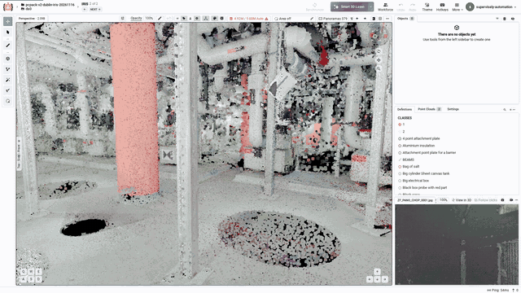<figcaption>
IRIS, 2.09 billion points. Data: Armangeon et al. 2026, CC BY-NC-ND 4.0 (GIF at 1.5× speed; the orbit after the fly-through is cut).
</figcaption></figure>

Scans like this one are made to answer questions about what was actually built:

* **As-built documentation and dimensional compliance.** Laser scans of a site are matched to the objects of its 3D CAD model to check the built dimensions against the design ([Bosché, 2010](https://doi.org/10.1016/j.aei.2009.08.006)).
* **Digital twins of industrial facilities.** The points of a plant scan are segmented by class, such as pipes, valves and structural elements ([Agapaki and Brilakis, 2020](https://doi.org/10.1016/j.aei.2020.101121)), and the labelled clusters are matched to CAD models of industrial shapes; the authors call manual twin generation tedious ([Agapaki and Brilakis, 2022](https://arxiv.org/abs/2202.04834)).
* **Parsing large indoor spaces.** Building-scale indoor scans are parsed into structural elements and objects ([Armeni et al., 2016](https://doi.org/10.1109/CVPR.2016.170)).
* **Renovation of existing buildings.** Elland Road Stadium was captured from 5,250 registered scan positions covering all stands, and the scan became a Revit model for future redevelopment ([RIEGL case study](https://www.riegl.com/en-austria/news-insights/article/high-speed-3d-capture-of-elland-road-stadium-with-the-riegl-vz-600i)).

Each of these needs labelled points: to train segmentation models, to check them, and to tie a structure in the scan to its object in a model. IRIS itself provides a CAD model, a P&ID and labels aligned with the scan in one coordinate frame.

## What Supervisely covers

* **Storing and viewing billion-point scans.** A cloud this size is kept as a streamed octree: the [3D point cloud editor](../labeling/3D-Point-Clouds/3D-point-cloud-episodes-2/README.md) loads the parts of it that the view needs, within a point budget, and shows the scanner's panoramas beside the points.
* **Point-level labels at building scale.** A structure is labelled as one object, however many points it holds: the `point_cloud_octree` geometry keeps millions of selected points in a single annotation instead of fragments. It can be converted to regular point cloud geometry where an existing pipeline needs it.
* **AI-assisted labeling.** The [3D AI Assistant](../labeling/3D-Point-Clouds/3D-point-cloud-episodes-2/README.md#3d-ai-assistant) places cuboids and labels the floor, reading only the part of the cloud it is pointed at.
* **Splitting the work.** An Area of Interest saved as an area is a part of the scan that a [labeling job](../labeling/jobs/README.md) can be made for. Review, [export](../data-organization/import/export/export.md) and the [API](https://developer.supervisely.com/) take the result further.

What gets faster: moving through the whole scan without cutting it into tiles first, and labelling a large structure as one object instead of in pieces.

## Import the data

### The sample project

The Ecosystem has a ready project for trying the workflow without uploading data: [Dublin City Aerial LiDAR](https://ecosystem.supervisely.com/projects/dublin-city-aerial-lidar-octree). It holds two point clouds cut from four aerial LiDAR tiles of central Dublin, 384.7 million points in total: an 80 × 80 m city block at full density and the 1 km² area of the four tiles thinned out, with empty classes for buildings, roofs, ground and vegetation. The data comes from the [Aerial Laser and Photogrammetry Survey of Dublin City, 2015](https://ultraviolet.library.nyu.edu/records/aqjnq-6c976) (Laefer et al., 2017, NYU Spatial Data Repository), under [CC BY 4.0](https://creativecommons.org/licenses/by/4.0/). Its page explains how to import the four original tiles as one streamed octree.

To add it, open the project's page in the **App Ecosystem** and click **Get project**. The project goes into the current team and workspace under the name given in the dialog. The copy runs as a task, and its output links to the new project.

<figure>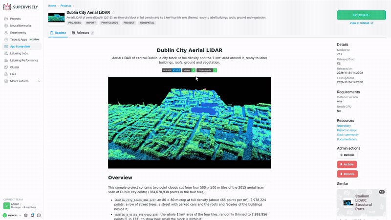<figcaption>
Adding the sample project (the wait for the task is cut).
</figcaption></figure>

### Other ways in

A project's **Import data** page has these options:

* **Quick Auto Import** takes `.pcd`, `.ply`, `.las` and `.laz` files by drag and drop. The [Auto Import](https://ecosystem.supervisely.com/apps/main-import) app also reads `E57`. A point cloud of more than 10,000,000 points is imported as a streamed octree; tiles of one scene in one folder that touch or overlap are merged into one cloud, and registered `E57` stations whose extents touch are merged as well. The panoramas and photos inside an `E57` file become related images of its cloud.
* **Cloud Storage**: data in a bucket (AWS S3, Google Cloud Storage, Azure Blob Storage) can be linked with **Import as Links** instead of uploaded, so it is not duplicated. See [Import from Cloud](../data-organization/import/import/import-from-cloud.md).
* **Team Files**: when point clouds are imported from Team Files as streamed octrees, files of 256 MiB or more are read while they download, so the import does not wait for the whole file first.
* **Command line interface (CLI)**, **Python** and the **API**, for imports from code: see the [Developer Portal](https://developer.supervisely.com/).

<figure>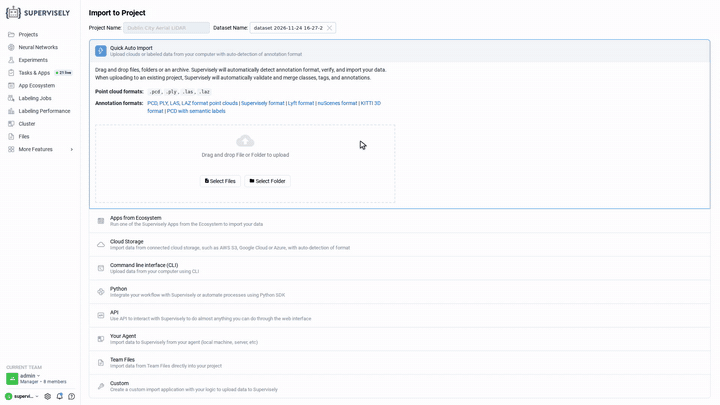<figcaption>
Upload, cloud storage and Team Files on the import page (GIF at 720 px).
</figcaption></figure>

## The 3D point cloud editor for billion-point scans

The editor is described in [3D Point Cloud and Episodes](../labeling/3D-Point-Clouds/3D-point-cloud-episodes-2/README.md), with its [navigation](../labeling/3D-Point-Clouds/3D-point-cloud-episodes-2/README.md#navigation-behavior) and [hotkeys](../labeling/3D-Point-Clouds/3D-point-cloud-episodes-2/README.md#hotkeys). Dense clouds render with WebGPU: see [Performance Upgrade for Dense Clouds](../labeling/3D-Point-Clouds/3D-point-cloud-episodes-2/3D-point-cloud-optimizations.md). In the Perspective view, `W` `A` `S` `D` fly forward, left, back and right, `E` and `Q` fly up and down, and `Home` frames the whole cloud. For a scan of billions of points, these parts matter.

### The point budget

The editor does not hold all 2.09 billion points on the GPU. It keeps a set number of points, the point budget, and draws the octree nodes the current view needs. The chip in the Perspective header opens **Point budget of the streamed cloud**: the points resident on the GPU, the points drawn, and the budget.

* **Auto** follows what frames cost on the GPU, and raises the budget while it limits detail and frames stay fast.
* **Manual** keeps the budget fixed; the editor keeps measuring but does not move it.

**Detail limited by the budget** means the view asks for more nodes than the budget allows. It is not an error. Here the budget goes to 10 million points in Manual mode, and the view moves closer, so more detail streams in.

<figure><figcaption>
Auto, then a manual budget of 10 million points (the zoom at 2.5× speed; GIF at 640 px and 1.5× speed).
</figcaption></figure>

The point budget changes what is streamed and drawn. It does not decimate the cloud or change a saved annotation.

### Panoramas

The scan's panoramas show as markers in the cloud; **Panoramas 379** in the header counts them, and a click on it goes inside the nearest one. A click on a marker goes inside that panorama, and the photo panel shows it with its file name. With **Follow clicks** on, a click on the cloud turns the photo to the panorama that sees that point best. The photo shows what a structure is and where it ends before it is labelled.

<figure>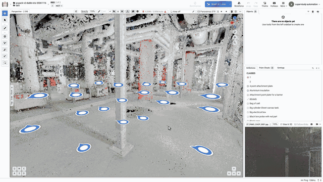<figcaption>
Into a panorama, then Follow clicks (GIF at 640 px).
</figcaption></figure>

### Area of Interest

In a room full of equipment, many structures overlap in every view. **Area of interest** in the left toolbar places a box that limits the view to one part of the scan. **Fit to view** places a box centred where the camera looks; the arrow on a face moves that face in or out (with `Alt`, the box keeps its centre). **Surroundings** sets whether the points outside the box show after **Done**, **Outline** keeps a thin box visible under the other tools, and holding **Preview** (`P`) shows the result before **Done** (`Enter`).

The box does more than hide points: under the other tools the point budget goes inside it, and selections take only the points inside it. The **Area** chip in the header turns it on and off (`Alt+A`) and says how much of the box has loaded.

<figure>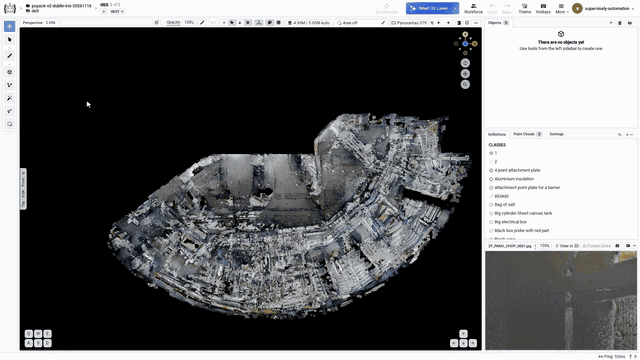<figcaption>
A box around the tank group (the drags at 2× speed; GIF at 640 px).
</figcaption></figure>

## AI on a streamed cloud

The [3D AI Assistant](https://ecosystem.supervisely.com/apps/3d-ai-assistant) is class-agnostic: it fits a cuboid around an object without having been trained on that kind of object. It runs as an app on a GPU agent of the team. On a streamed octree it reads only the part of the cloud the outline or the Area of Interest covers.

**Smart 3D Lasso** is in the top bar. With the class `tank` (Cuboid) chosen in its bar at the bottom of the view, a loop drawn around one tank gives a cuboid around it. The Top, Side and Front views and the photo panel show the new cuboid.

<figure>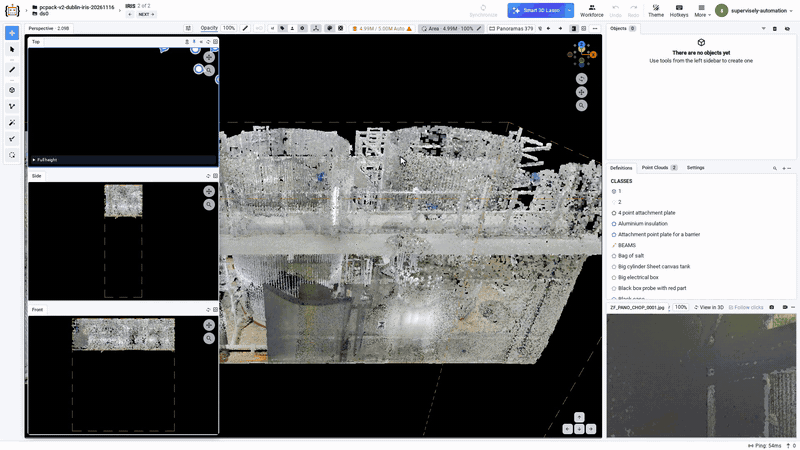<figcaption>
One loop, one tank (the wait while the AI fits the cuboid is shortened).
</figcaption></figure>

**Ground segmentation**, in the 3D AI Assistant's menu next to **Smart 3D Lasso**, labels the floor inside the Area of Interest as one point-level object of the class `Ground`, however many points it holds. On the 2.09-billion-point room it took two to three minutes.

<figure>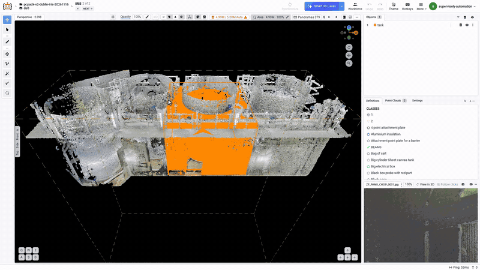<figcaption>
The floor of the area as one object (the ~3 minutes the command ran are cut).
</figcaption></figure>

**The AI does the bulk, the person corrects.** With the Select tool (`2`) and the cuboid selected, `B` fits it to the points inside it and `End` drops it onto the floor under it. Dragging the arrow on the top face brings the top down to the tank's top.

<figure>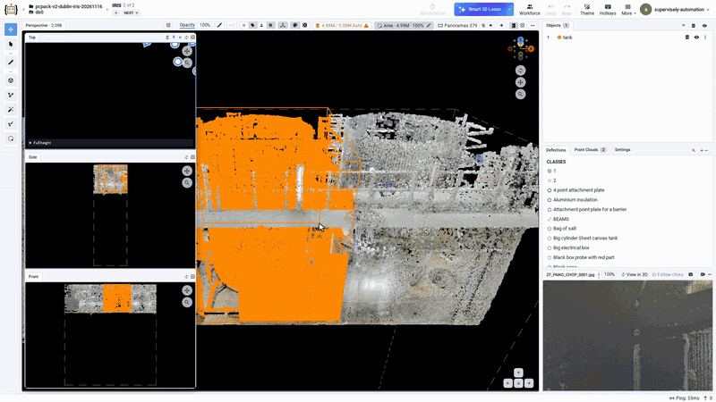<figcaption>
Fit, drop and resize the AI cuboid (the drag at 3× speed).
</figcaption></figure>

## One structure, one annotation

The [Point Cloud Pen](../labeling/3D-Point-Clouds/3D-point-cloud-episodes-2/README.md#3d-point-cloud-pen) (`5`) selects points inside an outline, through the depth of the scene by default. Holding `Alt` as the outline closes takes only the visible points. A double-click selects the object under the point: the selection grows over connected points, up to 3 m from the click. `Shift` takes points out instead of adding them.

Here, with the class `pipe` (Point Cloud), an outline along a pipe run takes its visible points, a double-click grows the selection over a missed section, and an outline with `Shift` takes a part back out. The pipe run is saved as one `point_cloud_octree` object, listed in the **Objects** panel.

<figure>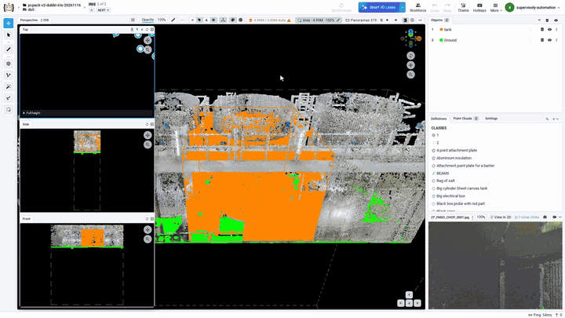<figcaption>
A pipe run as one object (the orbit at the end at 2× speed; GIF at 720 px).
</figcaption></figure>

A large selection on a large scene is bounded by the Area of Interest: an exact selection too big for the resources is refused with an error, never silently sampled.

**Areas for the team.** **Save as area** in the Area of Interest bar saves the box as a cuboid of an area class with a name, here `Tank group` of the class `Work area`. Saved areas are listed in the **Areas** panel, and **Create labeling jobs** there makes a job for each, so a team shares one scan area by area.

<figure>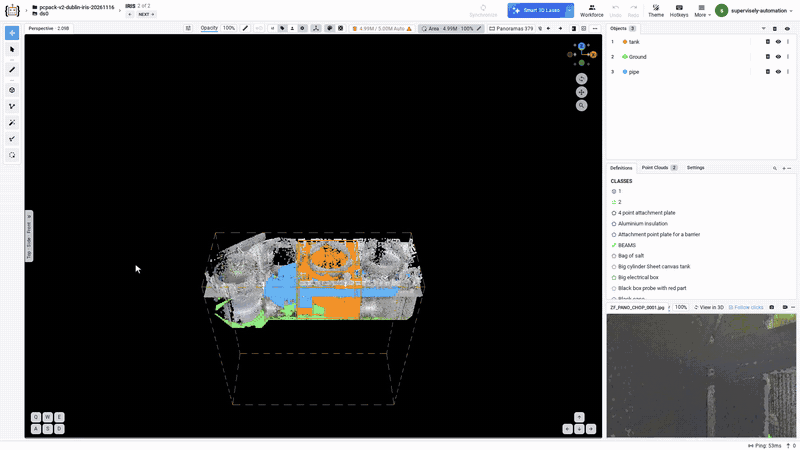<figcaption>
The box saved as an area (GIF at 10 fps).
</figcaption></figure>

## From labeled scans to as-built models and digital twins

Back to the uses this data serves:

* **As-built checks.** Each structure labelled as one object can be compared, object by object, with its counterpart in the design model.
* **Digital twins.** Point-level objects by class (pipes, the floor) and cuboids around equipment (tanks) are the labelled clusters that twin generation starts from, and the training data for segmentation models.
* **Indoor parsing and renovation.** Areas split a building-scale scan into parts that annotators and reviewers work on in parallel, without cutting the scan into files.

What it speeds up: the whole scan opens as one cloud, the Area of Interest isolates one part of it in a few drags, the 3D AI Assistant places cuboids and labels the floor, and a large structure stays one object.

<figure>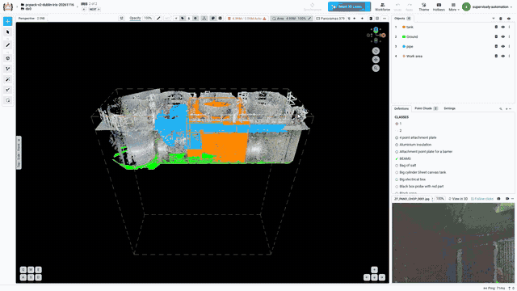<figcaption>
The labelled objects in the whole scene (GIF at 640 px).
</figcaption></figure>

Next steps:

* Split scans among a team with [labeling jobs](../labeling/jobs/README.md).
* [Export](../data-organization/import/export/export.md) the labels, or work with them through the [Python SDK and API](https://developer.supervisely.com/).
* See the AI models for point clouds in [Labeling with AI: 3D point clouds](../labeling/labeling-with-AI/3d-point-clouds/README.md).
