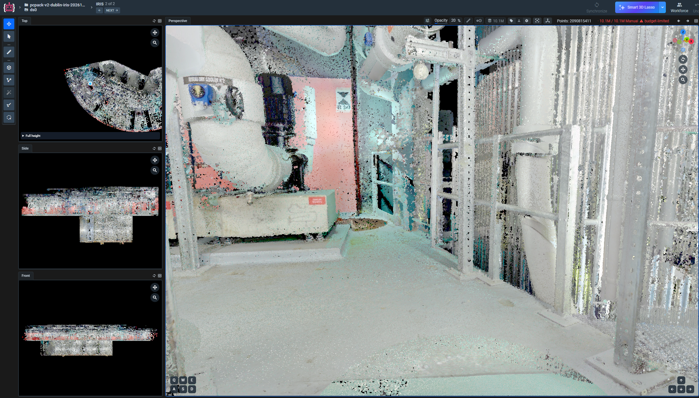
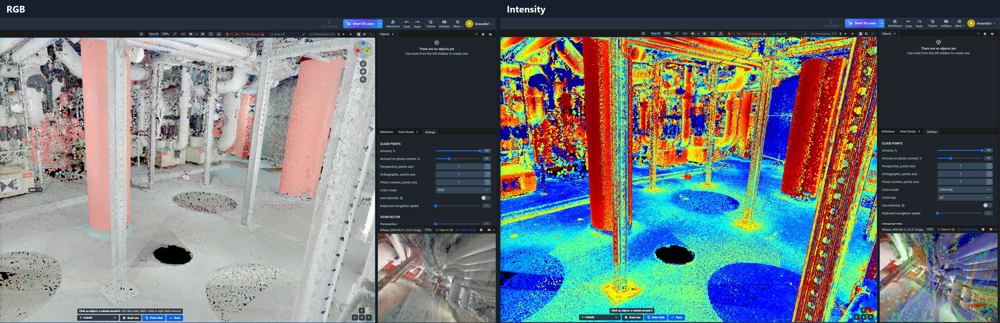
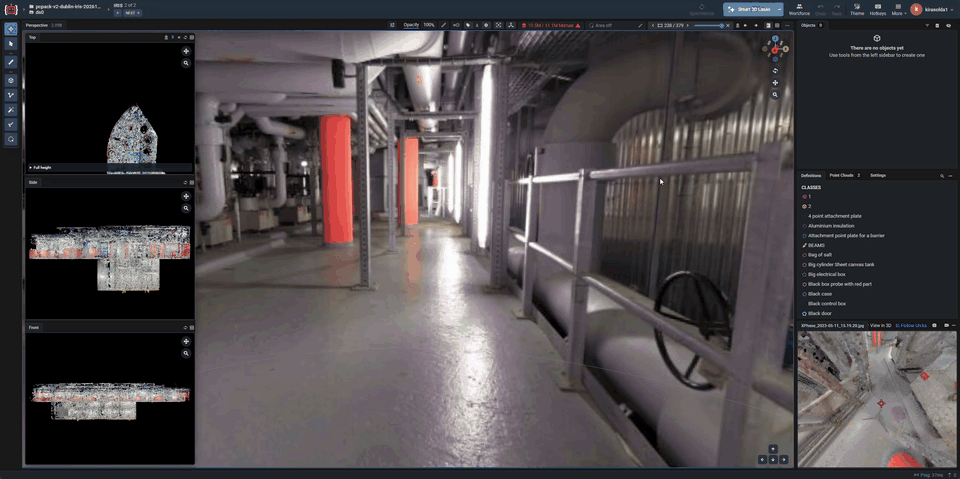
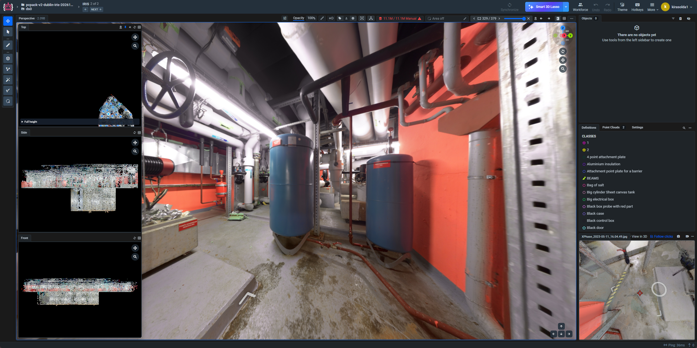
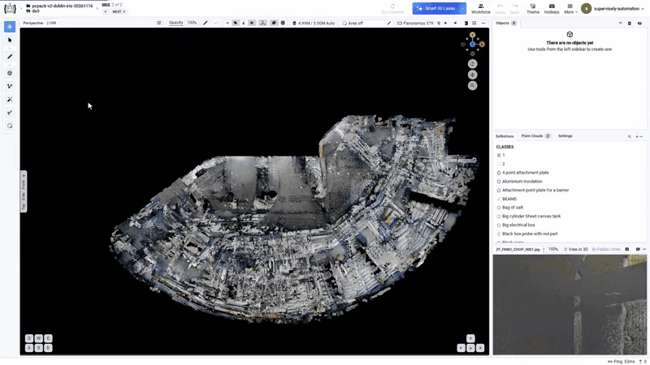
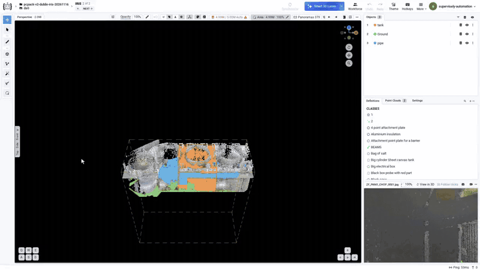
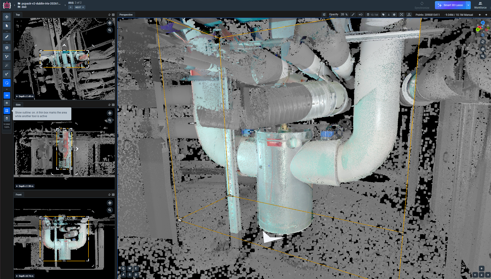
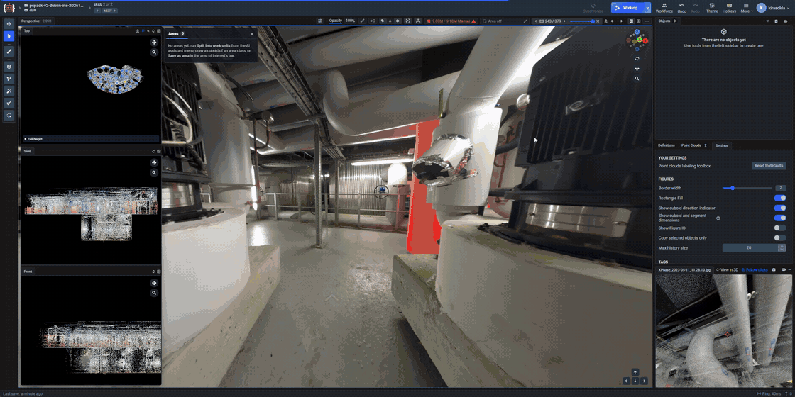
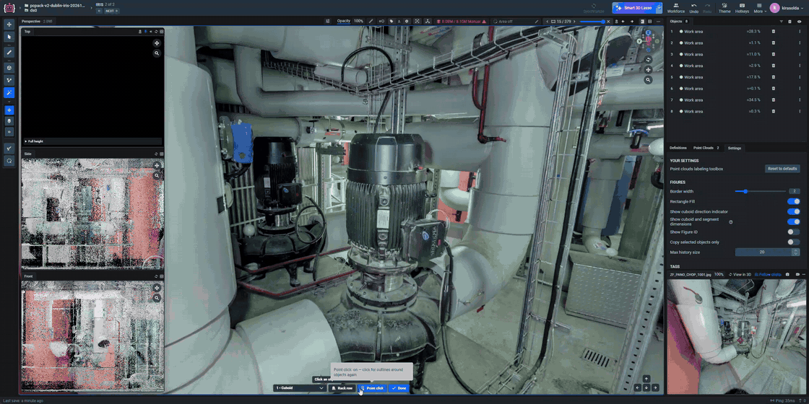

---
keywords:
  - large point cloud annotation
  - point cloud octree
  - massive lidar annotation
  - scan to bim annotation
  - building point cloud segmentation
  - area of interest point cloud
  - point cloud pen
  - building lidar scan
description: >-
  Explore and annotate billion-point LiDAR scans in Supervisely. Stream 3D
  detail as you work, inspect the scene with panoramas, and save millions of
  selected points as a single octree annotation.
---

# Annotate Massive Point Clouds with Octree Geometry

Use the [3D point cloud editor](../labeling/3D-Point-Clouds/3D-point-cloud-episodes-2/README.md) to inspect a building-scale scan, isolate a structure, and save its selected points as one octree annotation. The example in this guide uses a single building scan with **2,090,815,411 points** and **379 panoramas**.

For an overview of the workflow, see [Massive Point Cloud Annotation: Billions of Points in Your Browser](https://supervisely.com/blog/massive-point-cloud-annotation/).

## Set how many streamed points the editor draws

The editor streams the parts of the scan needed for the current view. Use **Point budget of the streamed cloud** to control how much detail is displayed. Available detail and performance depend on your browser and computer.

<figure><figcaption>
A 2.09-billion-point scene with a manual streamed-cloud budget of 3.10 million points.
</figcaption></figure>

- **Auto** uses GPU timing to adjust the point budget as you navigate.
- **Manual** keeps the budget at the value you select. Increase it when you need more visible detail at a boundary, or lower it if navigation slows down.

In the close-up below, the editor shows **budget-limited** at a manual budget of 10.1 million points. The current view could show more detail at a higher budget.

<figure><figcaption>
A close inspection with a 10.1-million-point manual budget; the current view still asks for more detail than the budget allows.
</figcaption></figure>


The point budget controls the detail streamed and drawn for the current view. Source points, saved annotations, and exported point counts are preserved.


## Switch between RGB and Intensity

Open **Settings**, then use **Cloud points** ? **Color mode** to switch between **RGB** and **Intensity** when the scan includes both attributes.

- **RGB** shows the colors captured at the site. Use it to recognize painted columns, pipes and equipment and match them to what you see in the panorama.
- **Intensity** colors points by the strength of the LiDAR return. Use the contrast to spot boundaries between surfaces that look similar in RGB, for example where a column meets the floor or where a pipe passes in front of a wall. Distance and scan angle also affect intensity, so use the panorama to check what you are looking at before tracing the boundary.

<figure><figcaption>
The same scan in RGB (left) and Intensity (right). Compare the columns, floor and pipes from the same viewpoint.
</figcaption></figure>

## Walk through the scan with panoramas

If the scan was captured together with panoramic photos, the editor can show them next to the points. The annotator can then move through the building from one panorama to the next, much like walking along a street in a map service, instead of orbiting the whole cloud from outside.

<figure><figcaption>
Walking through the scan panorama by panorama in View in 3D.
</figcaption></figure>

<figure><figcaption>
Panorama markers show where each of the 379 panoramas was captured in the scan.
</figcaption></figure>

At the top of the Perspective view:

- the counter, for example **329 / 379**, shows the current panorama and the total; the arrows on both sides switch to the previous or next one;
- **Show panoramas** (the marker icon) shows or hides the panorama markers in the scene.

The camera panel on the right shows the current panorama:

| Control | What it does |
| --- | --- |
| **View in 3D** | Look around this panorama in the Perspective view, from inside the cloud. |
| **Follow clicks** | A click on the cloud or on a selected object in the 3D views shows the panorama that sees it best, turned toward it. |
| Camera icon | Shows the points visible from the current camera. |

<figure><figcaption>
View in 3D: panorama 329 of 379 seen from inside the cloud in the Perspective view.
</figcaption></figure>

Use the panorama to check in the photo what a structure is and where its boundary lies before labeling it.

## Why one annotation can contain millions of points

A seating tier, floor slab or facade can span a large part of the scan and contain millions of points while remaining one structure. An octree annotation keeps the selected points for the component together so you can review it as one object.

## Isolate the structure with Area of Interest

In a dense building scan, several surfaces can fall on top of one another in a projection. Looking at a seating tier from the side may also show the level above it, columns behind it and part of the roof. Area of Interest narrows the working region to the component being labeled.

Select **Area of Interest** in the left toolbar and place the box in the Perspective view. Move, resize and rotate the box until it contains the component but excludes as much neighboring geometry as possible. The same area appears in the Perspective, Top, Side and Front views.

<figure><figcaption>
An Area of Interest around one column, shown in all four views; the toolbar for the box is at the bottom.
</figcaption></figure>

<figure><figcaption>
Set the Area of Interest and hide the surrounding points (2? speed).
</figcaption></figure>

### Area of Interest toolbar

While the tool is active, a toolbar at the bottom of the Perspective view controls the box:

| Button | What it does |
| --- | --- |
| **Surroundings** | Shows or hides the points outside the box. |
| **Outline** | Keeps a thin box around the area while another tool is active. |
| **Reset box** | Resets the box. |
| **Save as area** | Saves the box as a named area object of the cloud (a cuboid of an area class), listed in the **Areas** panel. |
| **Delete** | Removes the working box. |

### Save the box as an area

**Save as area** opens a dialog with two fields: **Class**, an existing area class or a new one, and **Name**, for example `Area 1`. After saving, the box becomes a cuboid of that class: an area of the cloud, listed in the **Areas** panel, that a [labeling job](../labeling/jobs/README.md) can be made for. This lets the team split work on a large scan by area.

<figure><figcaption>
Save the box as Tank group and find it in the Areas panel (1.5? speed).
</figcaption></figure>

### Hide or show the surroundings

**Surroundings** controls whether points outside the box remain visible:

- switch it **off** to hide outside points and work on the local structure without visual clutter;
- switch it **on** when the surrounding geometry is needed for orientation or for checking where the component meets its neighbors.

This setting changes visibility. The source scan and point labels are preserved.

<figure><figcaption>
Show surroundings off: points outside the Area of Interest are hidden to reduce visual clutter.
</figcaption></figure>

### Keep the area outline visible with another tool

Turn **Outline** on to leave a thin box around the Area of Interest while another annotation tool is active. The outline is useful when Point Cloud Pen, Lasso or another tool is being used: the annotator can still see the intended working region without returning to the Area of Interest tool.

<figure><figcaption>
Show outline on: a thin box keeps the working region visible while another tool is active.
</figcaption></figure>

## Split a scan into work units for labeling jobs

Use **Split into work units** to automatically divide a large scan into areas that your team can annotate and review separately. For example, in a warehouse, you can assign one annotator an aisle and another the ceiling above it. Each area is a 3D box in the same source scan, so the team can work in parallel without exporting separate point cloud files.

1. Open **AI Assistance Tools** from the dropdown next to **Smart 3D Lasso**, then select **Split into work units**. With **Area of Interest** off, the tool works on the whole scan. With it on, the tool splits only the active area.
2. Open the **Areas & QA** panel to review the generated areas, such as aisles, ceiling sections, or zones.
3. Create a separate [labeling job](../labeling/jobs/README.md) for each area you want to assign. The job opens in its assigned area, so annotators and reviewers can go straight to their part of the scan.

<figure><figcaption>
Review the generated work units and create labeling jobs from the Areas panel (2? speed, processing wait removed).
</figcaption></figure>

## Use AI assistance to label the scan

In **Smart 3D Lasso**, draw a rough outline around an object and use **Smart Lasso 3D Object Detection** to create a cuboid or select the object's points. **Smart Auto-Fit** fits newly placed cuboids to detected objects.

For enterprise workflows, outline a rack row with **Rack row** and use the custom **Rack Decompose** tool to create separate annotations for uprights, beams, decking, support bars, and guards.

## Select the structure's points

Select the target class and mark the structure with the [Point Cloud Pen](../labeling/3D-Point-Clouds/3D-point-cloud-episodes-2/README.md#3d-point-cloud-pen): single clicks place polygon points along straight edges, and click-and-drag paints over irregular areas. The same tool adds or removes points when the boundary needs correction.

### Select an object with Point Click

In **Smart 3D Lasso**, choose **Point Click** and click the object in the scan to select its points. Use positive clicks to include missed parts of the object and negative clicks to exclude neighboring surfaces. Check the updated highlight and select **Done** when it covers the object.

<figure><figcaption>
Selecting and refining the points of a pump with Point Click (2? speed).
</figcaption></figure>

The photo context panel in the lower right shows the corresponding 2D image. Annotations stay synchronized between the 3D view and the photo, so you can check the pump's outline in both views as you refine the selection.

## Keep the result as one octree annotation

Save the selection as a single octree annotation (`point_cloud_octree`). You can review the entire component as one object and convert the annotation to regular point cloud geometry when a training script, BIM tool, or engineering pipeline needs that format.

<figure><figcaption>
One octree annotation holds a 4.72 × 2.10 m wall section in the 2.09-billion-point scene.
</figcaption></figure>
