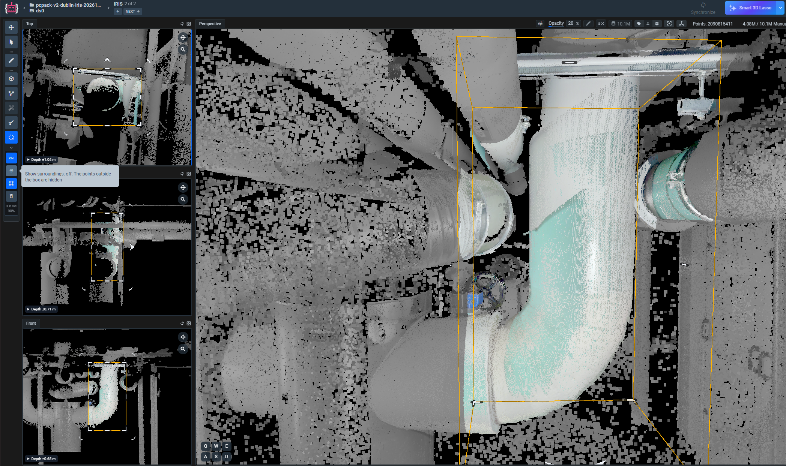

---
keywords:
  - large point cloud annotation
  - point cloud octree
  - massive lidar annotation
  - scan to bim annotation
  - building point cloud segmentation
  - area of interest point cloud
  - point cloud pen
  - stadium lidar scan
description: >-
  Annotate building-scale LiDAR scans in Supervisely: isolate one structure
  with an Area of Interest, keep millions of selected points in one
  point_cloud_octree annotation, and convert it when a regular point cloud is
  required downstream.
---

# Annotate Massive Point Clouds with Octree Geometry

## A building scan is geometry without meaning

Before an existing stadium, shopping center or other large building is renovated, engineers need an accurate record of what was actually built. Terrestrial laser scanners, mobile mapping systems and drones can capture the site as a dense point cloud, including structures that may differ from the original drawings.

The scan records where each visible surface is, but not what it represents. It does not distinguish a seating tier from the stairs beside it, a concrete slab from a facade, or a roof support from equipment behind it. Point-level labels add that structure to the raw coordinates.

The business question is therefore not “how do we label a big point cloud?” It is more specific:

> How do we keep a complete structural element as one point-level object when that element contains millions of points and overlaps other structures in the 3D view?

This matters in real renovation projects. At Elland Road Stadium, 5,250 registered scan positions covering the inside and outside of all stands supported a Revit model for future redevelopment ([RIEGL case study](https://www.riegl.com/en-austria/news-insights/article/high-speed-3d-capture-of-elland-road-stadium-with-the-riegl-vz-600i)). At Auburn Arena, an as-built scan of the bowl exposed stair-tread spacing that would not accommodate the designed seating count before the seats arrived ([Autodesk case study](https://images.autodesk.com/adsk/files/robins-morton-customer-story.pdf)). Shopping-center scans are similarly used to document architecture, structures and installations for BIM and asset management ([Hexagon case study](https://multivistaservices.hexagon.com/case-studies/shopping-mall-chain-in-madrid-spain/)).

<!--
MEDIA 1 — HERO
File: massive-point-cloud-octree/01-building-scan-overview.png
Capture: clean wide Perspective view of pointCloudId=7646416. The building must
be recognizable, not an unidentifiable close-up. Add the exact total point count
to the caption only after it is measured.
Caption: A building-scale point cloud containing [X] points in the Supervisely 3D editor.
-->

## What Supervisely covers

Supervisely keeps the workflow in the [3D point cloud editor](../labeling/3D-Point-Clouds/3D-point-cloud-episodes-2/README.md):

- **One editor for the whole scan.** Perspective, Top, Side and Front views show the same registered scene and let the annotator inspect a component from different directions.
- **A streamed point budget.** Auto or Manual mode controls how many points are resident and drawn for the current view, balancing visible detail against GPU workload.
- **A local working region.** **Area of Interest** places an oriented 3D box around the part of the scene being labeled. Selected fitting and point-growing operations then use only points inside that box.
- **Point-level geometry at building scale.** The new `point_cloud_octree` geometry keeps a very large selection as one logical annotation instead of forcing it into arbitrary fragments solely because of its point count.
- **A path to existing pipelines.** An octree annotation can be converted to regular point cloud geometry when a customer's ML, BIM or engineering workflow requires it.
- **Teamwork and delivery.** [Labeling jobs](../labeling/jobs/README.md) split scenes among annotators and reviewers, while [export](../data-organization/import/export/export.md) and the API connect the approved result to downstream systems.


`point_cloud_octree` is an annotation geometry type, while Area of Interest is temporary editor context. The area is not an annotation and does not crop or modify the source point cloud.


## Set how many streamed points the editor draws

The complete scene in this example contains **2,090,815,411 points**. The editor does not need to place all 2.09 billion points in GPU memory at the same time. It streams the spatial nodes needed for the current camera and draws them within the **Point budget of the streamed cloud**.

The screenshot shows a manual budget of 3.10 million points. At that moment, 3.08 million points are resident and the same 3.08 million are drawn. The red **budget-limited** status means the current view requests more octree nodes than the selected budget permits: 230 of 322 wanted nodes remain unloaded, so additional detail is available but is not drawn at this budget.

<figure><figcaption>
A 2.09-billion-point scene with a manual streamed-cloud budget of 3.10 million points.
</figcaption></figure>

The two modes serve different purposes:

- **Auto** uses GPU timing measurements to adjust the point budget and keep navigation responsive as the view changes.
- **Manual** keeps the selected point budget fixed. The editor continues measuring the GPU workload but does not move the budget automatically.

Raise the manual budget when a boundary needs more visible detail and the workstation has enough GPU capacity. Lower it when orbiting or zooming becomes slow. The maximum and GPU-buffer values shown in the dialog describe the current browser and device; they are not a universal limit for every installation.

For the close inspection below, the manual budget is raised to 10.1 million points. The top bar still reports **budget-limited** because the detailed view requests more data than even this larger budget allows. This status is not an error: it says that the selected budget is full and that more spatial detail could be streamed if the budget were raised again.

<figure><figcaption>
A close inspection with a 10.1-million-point manual budget; the current view still asks for more detail than the budget allows.
</figcaption></figure>


The point budget controls streaming and display detail. It does not delete points, decimate the source cloud, change the saved `point_cloud_octree` annotation, or reduce the point count delivered downstream.


## Choose components that match the downstream task

Name classes after the structures the customer needs, not just the building type. For a stadium renovation, these may be `seating_tier`, `stairs`, `concrete_structure`, `railing`, `column`, `roof_structure`, `equipment` and `noise`; for a shopping center, floor slabs, walls, columns, facades, escalators and parking levels.

Decide before production whether the output is semantic (every point labeled `floor`, `wall` or `column`) or instance-based (each column or slab as a separate object, as Scan-to-BIM often requires), and write it into the guidelines.

## Why one annotation can contain millions of points

A seating tier, floor slab or facade can span a large part of the scan and contain millions of points while remaining one structure. Splitting it into fragments just to fit a size limit adds review work and creates false boundaries between parts. With `point_cloud_octree`, the whole component stays one point-level annotation.

<!--
MEDIA 2 — SCALE OF ONE OBJECT
File: massive-point-cloud-octree/02-target-structure.png
Capture: the target structure in the complete scene before Area of Interest is
enabled. Keep neighboring geometry visible. If the UI exposes the object or
scene point count, include it without covering the geometry.
Caption: The [exact structure] is one logical object even though it contains [Y] points.
-->

## Isolate the structure with Area of Interest

In a dense building scan, several surfaces can fall on top of one another in a projection. Looking at a seating tier from the side may also show the level above it, columns behind it and part of the roof. A point-growing operation needs a spatial limit that matches the component being labeled.

Select **Area of Interest** in the left toolbar, then click and drag in the Perspective view to place an oriented box around the target. Move, resize and rotate the box until it contains the component but excludes as much neighboring geometry as possible. The same area appears in the Perspective, Top, Side and Front views.

While the area is enabled:

- **Fit to points** uses only points inside it;
- **Drop to ground** uses only points inside it;
- single-click growing with **Point Cloud Pen** uses only points inside it;
- Lasso, Brush and direct point clicks can still see points across the scene.

The area can be disabled or removed when the local operation is finished. It is workspace context for the current session: it is not saved as an object, and editing it is not an annotation change.

### Hide or show the surroundings

The **ON** switch enables or disables the existing Area of Interest without requiring the box to be placed again. **Show surroundings** controls whether points outside the box remain visible:

- switch it **off** to hide outside points and work on the local structure without visual clutter;
- switch it **on** when the surrounding geometry is needed for orientation or for checking where the component meets its neighbors.

This is a visibility setting. Hiding the surroundings does not remove points from the source scene or add them to the annotation.

<figure><figcaption>
Show surroundings off: points outside the Area of Interest are hidden to reduce visual clutter.
</figcaption></figure>

### Keep the area outline visible with another tool

Turn **Show outline** on to leave a thin box around the Area of Interest while another annotation tool is active. The outline is useful when Point Cloud Pen, Lasso or another tool is being used: the annotator can still see the intended working region without returning to the Area of Interest tool.

The outline is only a visual reference. It does not become an annotation and does not change the box's filtering behavior.

<figure><figcaption>
Show outline on: a thin box keeps the working region visible while another tool is active.
</figcaption></figure>

<!--
MEDIA 3 — PLACE AREA OF INTEREST
File: massive-point-cloud-octree/03-place-area-of-interest.gif
Capture, 10–20 s: click the new button in the left toolbar; click-drag in
Perspective; fit the box around the target; adjust one edge in a projection;
pause on the final box. Keep the tooltip closed.
Caption: Place and adjust an oriented Area of Interest around the structure being annotated.
-->

<!--
MEDIA 4 — AREA IN FOUR VIEWS
File: massive-point-cloud-octree/04-area-four-views.png
Capture: final box visible in Perspective, Top, Side and Front. Make one
projection large enough to show that a neighboring level is outside the box.
Caption: One Area of Interest limits the working region in all four views.
-->

## Grow the point selection inside the area

Select the target class and start a point-level object with **Point Cloud Pen**. A single click can grow the selection across connected points, but with Area of Interest enabled it considers only the points inside the oriented box. The target structure is selected without the operation continuing into a neighboring level or geometry behind it.

<!--
MEDIA 5 — POINT GROWING
File: massive-point-cloud-octree/05-grow-selection-inside-area.gif
Capture, 10–25 s: with the area already fitted, create/grow the target point
selection; show nearby geometry staying unselected; orbit or enlarge one
projection to check the boundary.
Caption: Point growing follows the target inside the Area of Interest without capturing nearby structures.
-->


Area of Interest is not a universal visibility filter. Lasso, Brush and direct point clicks still operate on the points they can reach in the scene. Check which operation is active before making a large edit.


## Keep the result as one octree annotation

Save the completed selection as `point_cloud_octree` geometry. In the example for this page, the finished `[structure]` contains `[Y]` points and remains one object of class `[class]`.

The geometry type changes how a very large point-level annotation is represented. It does not change its semantic role: the annotation still says that all of these points belong to the same physical component.

<!--
MEDIA 6 — COMPLETED OCTREE OBJECT
File: massive-point-cloud-octree/06-complete-octree-object.png
Capture: finished object selected; show class, object name, geometry type and
point count wherever the UI exposes them. Do not add an estimated count.
Caption: One point_cloud_octree annotation holds the complete [structure], [Y] points.
-->

<!--
MEDIA 7 — BEFORE / AFTER
Files:
  massive-point-cloud-octree/07a-raw-scan.png
  massive-point-cloud-octree/07b-labeled-structure.png
Capture: identical camera, point size and color settings. First raw, then the
completed annotation highlighted. Present as two figures or a slider in the blog.
Caption: Raw coordinates become a structured point-level building component.
-->

## Summary

A building-scale scan can contain billions of points, and a single structure in it can contain millions. Supervisely handles both: the streamed point budget keeps the full scene navigable, Area of Interest limits point growing to one structure, and `point_cloud_octree` keeps that structure as one annotation, ready for model training, Scan-to-BIM or comparison with a design.
