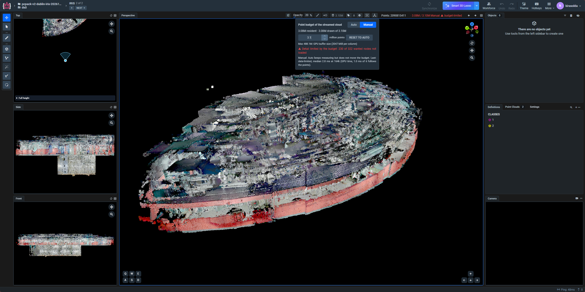
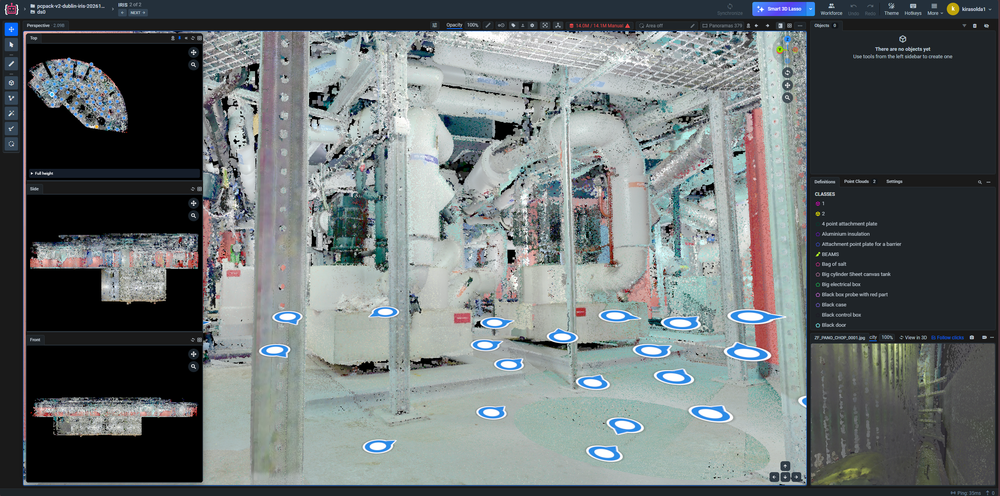
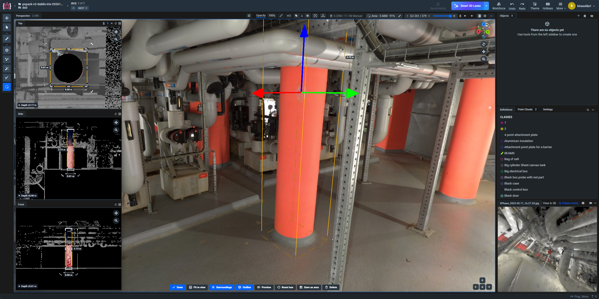
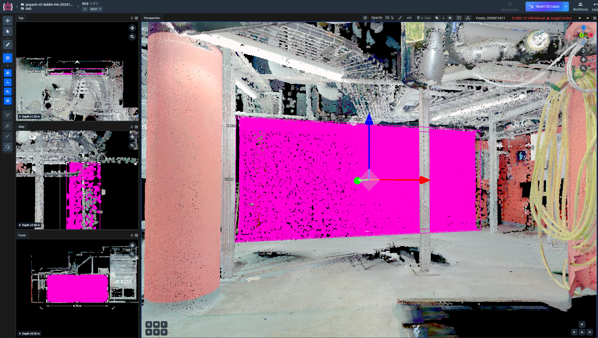

---
keywords:
  - large point cloud annotation
  - point cloud octree
  - massive lidar annotation
  - scan to bim annotation
  - building point cloud segmentation
  - area of interest point cloud
  - point cloud pen
  - stadium lidar scan
description: >-
  Annotate building-scale LiDAR scans in Supervisely: isolate one structure
  with an Area of Interest, keep millions of selected points in one
  point_cloud_octree annotation, and convert it when a regular point cloud is
  required downstream.
---

# Annotate Massive Point Clouds with Octree Geometry

## A building scan is geometry without meaning

Before an existing stadium, shopping center or other large building is renovated, engineers need an accurate record of what was actually built. Terrestrial laser scanners, mobile mapping systems and drones can capture the site as a dense point cloud, including structures that may differ from the original drawings.

The scan records where each visible surface is, but not what it represents. It does not distinguish a seating tier from the stairs beside it, a concrete slab from a facade, or a roof support from equipment behind it. Point-level labels add that structure to the raw coordinates.

The business question is therefore not “how do we label a big point cloud?” It is more specific:

> How do we keep a complete structural element as one point-level object when that element contains millions of points and overlaps other structures in the 3D view?

This matters in real renovation projects. At Elland Road Stadium, 5,250 registered scan positions covering the inside and outside of all stands supported a Revit model for future redevelopment ([RIEGL case study](https://www.riegl.com/en-austria/news-insights/article/high-speed-3d-capture-of-elland-road-stadium-with-the-riegl-vz-600i)). At Auburn Arena, an as-built scan of the bowl exposed stair-tread spacing that would not accommodate the designed seating count before the seats arrived ([Autodesk case study](https://images.autodesk.com/adsk/files/robins-morton-customer-story.pdf)). Shopping-center scans are similarly used to document architecture, structures and installations for BIM and asset management ([Hexagon case study](https://multivistaservices.hexagon.com/case-studies/shopping-mall-chain-in-madrid-spain/)).

## What Supervisely covers

Supervisely keeps the workflow in the [3D point cloud editor](../labeling/3D-Point-Clouds/3D-point-cloud-episodes-2/README.md):

- **One editor for the whole scan.** Perspective, Top, Side and Front views show the same registered scene and let the annotator inspect a component from different directions.
- **A streamed point budget.** Auto or Manual mode controls how many points are resident and drawn for the current view, balancing visible detail against GPU workload.
- **Panoramas next to the points.** When a scan includes panoramic photos, the annotator can walk through the building panorama by panorama and open the photo that shows a clicked point best.
- **A local working region.** **Area of Interest** places an oriented 3D box around the part of the scene being labeled.
- **Point-level geometry at building scale.** The new `point_cloud_octree` geometry keeps a very large selection as one logical annotation instead of forcing it into arbitrary fragments solely because of its point count.
- **A path to existing pipelines.** An octree annotation can be converted to regular point cloud geometry when a customer's ML, BIM or engineering workflow requires it.
- **Teamwork and delivery.** [Labeling jobs](../labeling/jobs/README.md) split scenes among annotators and reviewers, while [export](../data-organization/import/export/export.md) and the API connect the approved result to downstream systems.


`point_cloud_octree` is an annotation geometry type, while Area of Interest is a working box in the editor. It does not crop or modify the source point cloud and becomes an object only when saved with **Save as area**.


## Set how many streamed points the editor draws

The complete scene in this example contains **2,090,815,411 points**. The editor does not need to place all 2.09 billion points in GPU memory at the same time. It streams the spatial nodes needed for the current camera and draws them within the **Point budget of the streamed cloud**.

The screenshot shows a manual budget of 3.10 million points. At that moment, 3.08 million points are resident and the same 3.08 million are drawn. The red **budget-limited** status means the current view requests more octree nodes than the selected budget permits: 230 of 322 wanted nodes remain unloaded, so additional detail is available but is not drawn at this budget.

<figure><figcaption>
A 2.09-billion-point scene with a manual streamed-cloud budget of 3.10 million points.
</figcaption></figure>

The two modes serve different purposes:

- **Auto** uses GPU timing measurements to adjust the point budget and keep navigation responsive as the view changes.
- **Manual** keeps the selected point budget fixed. The editor continues measuring the GPU workload but does not move the budget automatically.

Raise the manual budget when a boundary needs more visible detail and the workstation has enough GPU capacity. Lower it when orbiting or zooming becomes slow. The maximum and GPU-buffer values shown in the dialog describe the current browser and device; they are not a universal limit for every installation.

For the close inspection below, the manual budget is raised to 10.1 million points. The top bar still reports **budget-limited** because the detailed view requests more data than even this larger budget allows. This status is not an error: it says that the selected budget is full and that more spatial detail could be streamed if the budget were raised again.

<figure><figcaption>
A close inspection with a 10.1-million-point manual budget; the current view still asks for more detail than the budget allows.
</figcaption></figure>


The point budget controls streaming and display detail. It does not delete points, decimate the source cloud, change the saved `point_cloud_octree` annotation, or reduce the point count delivered downstream.


## Walk through the scan with panoramas

If the scan was captured together with panoramic photos, the editor can show them next to the points. The annotator can then move through the building from one panorama to the next, much like walking along a street in a map service, instead of orbiting the whole cloud from outside.

<figure><figcaption>
Walking through the scan panorama by panorama in View in 3D.
</figcaption></figure>

<figure><figcaption>
Panorama markers show where each of the 379 panoramas was captured in the scan.
</figcaption></figure>

At the top of the Perspective view:

- the counter, for example **329 / 379**, shows the current panorama and the total; the arrows on both sides switch to the previous or next one;
- **Show panoramas** (the marker icon) shows or hides the panorama markers in the scene.

The camera panel on the right shows the current panorama:

| Control | What it does |
| --- | --- |
| **View in 3D** | Look around this panorama in the Perspective view, from inside the cloud. |
| **Follow clicks** | A click on the cloud or on a selected object in the 3D views shows the panorama that sees it best, turned toward it. |
| Camera icon | Colors the points from this camera and shows only the points it can see. |
| Video camera icon | Adds a new camera tab. |

<figure><figcaption>
View in 3D: panorama 329 of 379 seen from inside the cloud in the Perspective view.
</figcaption></figure>

Use the panorama to check in the photo what a structure is and where its boundary lies before labeling it.

## Choose components that match the downstream task

Name classes after the structures the customer needs, not just the building type. For a stadium renovation, these may be `seating_tier`, `stairs`, `concrete_structure`, `railing`, `column`, `roof_structure`, `equipment` and `noise`; for a shopping center, floor slabs, walls, columns, facades, escalators and parking levels.

Decide before production whether the output is semantic (every point labeled `floor`, `wall` or `column`) or instance-based (each column or slab as a separate object, as Scan-to-BIM often requires), and write it into the guidelines.

## Why one annotation can contain millions of points

A seating tier, floor slab or facade can span a large part of the scan and contain millions of points while remaining one structure. Splitting it into fragments just to fit a size limit adds review work and creates false boundaries between parts. With `point_cloud_octree`, the whole component stays one point-level annotation.

## Isolate the structure with Area of Interest

In a dense building scan, several surfaces can fall on top of one another in a projection. Looking at a seating tier from the side may also show the level above it, columns behind it and part of the roof. Area of Interest narrows the working region to the component being labeled.

Select **Area of Interest** in the left toolbar, then click a point in the Perspective view to place the box and drag to size it. Move, resize and rotate the box until it contains the component but excludes as much neighboring geometry as possible. The same area appears in the Perspective, Top, Side and Front views.

<figure><figcaption>
An Area of Interest around one column, shown in all four views; the toolbar for the box is at the bottom.
</figcaption></figure>

### Area of Interest toolbar

While the tool is active, a toolbar at the bottom of the Perspective view controls the box:

| Button | What it does |
| --- | --- |
| **Surroundings** | Shows or hides the points outside the box. |
| **Outline** | Keeps a thin box around the area while another tool is active. |
| **Reset box** | Undoes the changes made to the box since you started editing it. |
| **Save as area** | Saves the box as a named area object of the cloud (a cuboid of an area class), listed in the **Areas** panel. |
| **Delete** (`Backspace`) | Deletes the box; the whole cloud is shown again. |

### Save the box as an area

**Save as area** opens a dialog with two fields: **Class**, an existing area class or a new one, and **Name**, for example `Area 1`. After saving, the box becomes a cuboid of that class: an area of the cloud, listed in the **Areas** panel, that a [labeling job](../labeling/jobs/README.md) can be made for. This lets the team split work on a large scan by area.

### Hide or show the surroundings

**Surroundings** controls whether points outside the box remain visible:

- switch it **off** to hide outside points and work on the local structure without visual clutter;
- switch it **on** when the surrounding geometry is needed for orientation or for checking where the component meets its neighbors.

This is a visibility setting. Hiding the surroundings does not remove points from the source scene or add them to the annotation.

<figure><figcaption>
Show surroundings off: points outside the Area of Interest are hidden to reduce visual clutter.
</figcaption></figure>

### Keep the area outline visible with another tool

Turn **Outline** on to leave a thin box around the Area of Interest while another annotation tool is active. The outline is useful when Point Cloud Pen, Lasso or another tool is being used: the annotator can still see the intended working region without returning to the Area of Interest tool.

The outline is only a visual reference and does not become an annotation.

<figure><figcaption>
Show outline on: a thin box keeps the working region visible while another tool is active.
</figcaption></figure>

## Select the structure's points

Select the target class and mark the structure with the [Point Cloud Pen](../labeling/3D-Point-Clouds/3D-point-cloud-episodes-2/README.md#3d-point-cloud-pen): single clicks place polygon points along straight edges, and click-and-drag paints over irregular areas. The same tool adds or removes points when the boundary needs correction.

## Keep the result as one octree annotation

Save the completed selection as `point_cloud_octree` geometry.

The geometry type changes how a very large point-level annotation is represented. It does not change its semantic role: the annotation still says that all of these points belong to the same physical component.

<figure><figcaption>
One <code>point_cloud_octree</code> annotation holds a 4.72 × 2.10 m wall section in the 2.09-billion-point scene.
</figcaption></figure>

## Summary

A building-scale scan can contain billions of points, and a single structure in it can contain millions. Supervisely handles both: the streamed point budget keeps the full scene navigable, Area of Interest isolates one structure from its surroundings, and `point_cloud_octree` keeps that structure as one annotation, ready for model training, Scan-to-BIM or comparison with a design.
